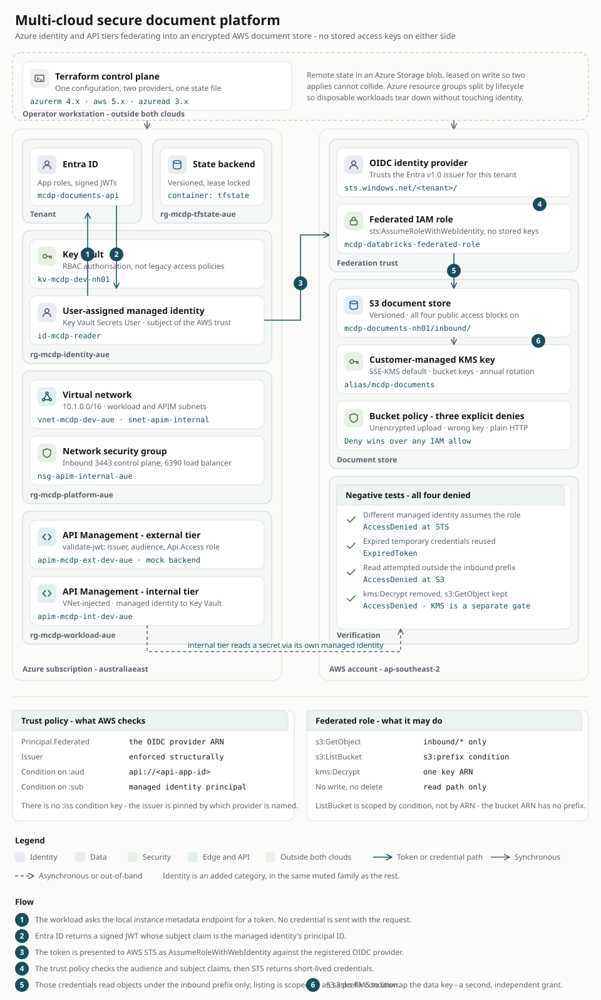

# Multi-Cloud Secure Document Platform

Cross-cloud OIDC workload identity federation between Azure and AWS, provisioned from a
single Terraform configuration. An Azure workload reads an encrypted S3 bucket with **no AWS
access key stored anywhere on the Azure side**, and the access boundaries are proven by
negative tests rather than assumed.

> **Status:** personal lab project. The AWS side is deployed; the Azure side has been torn
> down since the trial subscription expired. See [Limitations](#limitations).

---

## The problem

An organisation runs primarily on one cloud and introduces a second. Documents land in AWS
S3; analytics runs on the Azure side. One question forces itself immediately:

> How does a compute workload in one cloud authenticate to storage in another, without an
> access key sitting in a config file?

The answer is OIDC workload identity federation. Everything else here exists to make that
answer defensible — a storage layer worth protecting, two API tiers with genuinely different
threat models, and tests that prove the denials.

---

## Architecture



Three calls, all originating from the Azure side. AWS never initiates anything and never
reaches into Azure.

```
Azure workload  ──▶  Entra ID            get a signed token
Azure workload  ──▶  AWS STS             exchange it for short-lived credentials
Azure workload  ──▶  S3 + KMS            read one prefix, decrypt with one key
```

**No network path between the clouds is required.** AWS validates the token offline against
Entra's published JWKS keys, so trust is cryptographic rather than network-based.

---

## What is here

### Federation (`main.tf`)

| Resource | Purpose |
|---|---|
| `aws_iam_openid_connect_provider.entra` | Registers the Entra v1.0 issuer as a trusted OIDC provider |
| `aws_iam_role.databricks_federated` | Trust policy conditioned on the `:aud` and `:sub` claims |
| `aws_iam_role_policy.databricks_s3_read` | `s3:GetObject` on one prefix, prefix-scoped `s3:ListBucket`, `kms:Decrypt` on one key |

Two details worth knowing:

- **There is no `:iss` condition key in IAM.** The issuer is enforced structurally, by which
  OIDC provider ARN is named as `Principal.Federated`. Only `aud` and `sub` exist as
  condition keys.
- **`s3:ListBucket` is scoped by condition, not by ARN.** A bucket ARN has no prefix
  component, so the restriction has to be expressed as a `s3:prefix` condition.

### Storage (`main.tf`)

S3 with SSE-KMS by default using a customer-managed key, bucket keys enabled, versioning on,
and all four public access blocks set. The bucket policy carries three explicit denies:

| Sid | Denies |
|---|---|
| `DenyUnencryptedUploads` | A `PutObject` that is not SSE-KMS |
| `DenyWrongKey` | A `PutObject` encrypted under any other key |
| `DenyInsecureTransport` | Any action arriving over plain HTTP |

Explicit `Deny` in a resource policy beats any IAM allow, including the account root.

Both use `StringNotEqualsIfExists`. A request that sends no encryption header at all falls
through to the bucket default; only a request that explicitly asks for the wrong thing is
denied. With a bare `StringNotEquals`, an absent header counts as "not equal" and the deny
fires on every ordinary upload.

### API tiers (`apim_external.tf`, `apim_internal.tf`, `entra_api_auth.tf`)

External and internal traffic have different threat models and should not share a security
posture.

| | External tier | Internal tier |
|---|---|---|
| Exposure | Public gateway | VNet-injected, private IP only |
| Authentication | `validate-jwt` — issuer, audience, required `Api.Access` app role | System-assigned managed identity |
| Backend | Mock response (see below) | Key Vault, via `authentication-managed-identity` |
| Threat assumed | Token theft and replay | Lateral movement, over-broad service permissions |

A stolen bearer token works from anywhere; a platform-native identity cannot be lifted out of
the request. That asymmetry is the reason for the split.

The external tier's `/upload-url` operation **returns a mock response**. It is a working auth
gate in front of nothing — the JWT validation is real, the backend is not implemented.

### Infrastructure as code

One configuration, three providers (`azurerm`, `aws`, `azuread`), one state file. Remote
state lives in an Azure Storage blob with **lease-based locking** — Azure Blob has a native
lease primitive, where the AWS equivalent needs S3 plus a DynamoDB table.

Several resources were built by CLI first and brought under management with
`terraform import`. Import writes state, not HCL: the config is still hand-written, and the
work is reconciling the first `plan` until it comes back clean.

---

## Negative tests

The point of the project. Each was run and each produced the expected denial.

| Test | Result | What it proves |
|---|---|---|
| A different Entra managed identity attempts the exchange | `AccessDenied` at STS | The `sub` condition is load-bearing, not decorative |
| Reuse credentials past expiry | `ExpiredToken` | Credentials are genuinely short-lived |
| Read outside the permitted prefix | `AccessDenied` at S3 | The policy scopes the role, not just the bucket |
| Remove `kms:Decrypt`, keep `s3:GetObject` | `AccessDenied` | Key authorisation is a separate surface |

The fourth is the interesting one. An object encrypted with a customer-managed key is guarded
by **two independent policies** — the bucket policy and the key policy — and both must allow.
Removing the KMS grant breaks the read while the bucket policy still looks correct, and the
error surfaces as an S3 `AccessDenied` with no mention of KMS.

Disabling the key itself is clearer about the cause:

```
An error occurred (KMS.DisabledException) when calling the GetObject operation:
arn:aws:kms:...:key/... is disabled.
```

**A negative test is only valid if the acting identity is confirmed first.** An early run of
these gave a false pass because the login had silently failed and the commands ran as
subscription Owner. `az account show --query user -o json` before trusting any result.

---

## Repository layout

```
.
├── main.tf              providers, resource groups, Key Vault, VNet,
│                        S3 + KMS + bucket policy, OIDC provider, federated role
├── backend.tf           remote state in an Azure Storage blob
├── apim_external.tf     public API Management tier, JWT validation policy
├── apim_internal.tf     VNet-injected tier, managed identity to Key Vault
├── entra_api_auth.tf    app registration, Api.Access app role, test client
├── variables.tf         tenant, subscription and application identifiers
├── terraform.tfvars.example
└── docs/
    ├── design-decisions.md
    └── diagrams/
```

---

## Running it

Requires Terraform 1.5+, an Azure subscription and an AWS account.

```bash
cp terraform.tfvars.example terraform.tfvars   # fill in your own identifiers
terraform init
terraform fmt && terraform validate
terraform plan
```

**Read the plan before applying.** A `-/+` means destroy and recreate, which on a Key Vault or
a storage account is destructive and easy to miss.

Register the Azure resource providers first on a new subscription, or `apply` will fail
partway through with `MissingSubscriptionRegistration`:

```bash
az provider register --namespace Microsoft.KeyVault
az provider register --namespace Microsoft.Network
az provider register --namespace Microsoft.Storage
az provider register --namespace Microsoft.ManagedIdentity
az provider register --namespace Microsoft.ApiManagement
```

### Cost

API Management on the Developer tier bills by the hour and takes 30–45 minutes to provision.
The KMS key is about a dollar a month. Everything else sits inside the free tiers. Tear down
by resource group rather than by resource — deleting a VM individually leaves the disk, NIC,
public IP and NSG behind, and the disk and public IP keep billing.

---

## Limitations

Stated plainly, because a claim that collapses under one follow-up costs more than it gains.

- **The Azure side is torn down.** The trial subscription expired, so the Terraform state blob
  is unreachable and the Azure resources no longer exist. The configuration is what remains.
  The AWS side is still deployed.
- **Terraform here is project-built, not production.** My production infrastructure-as-code
  experience is CDK and CloudFormation.
- **No CI/CD.** There is no pipeline in this repository.
- **No governance layer.** No management group hierarchy, no inherited Azure Policy. This is a
  Terraform-managed estate with remote state and locking, not a landing zone.
- **The external API tier has no backend.** It validates a JWT and returns a mock response.
- **No WAF.** Nothing in this repository configures one.
- **One custom RBAC role** (`Document Platform Operator`) was built by CLI during an earlier
  phase and never imported, so it does not appear here.
- **An open question:** with these bucket policy denies in place, `aws s3 cp` is refused while
  an explicit `aws s3api put-object --server-side-encryption aws:kms --ssekms-key-id <arn>`
  succeeds. The CLI's transfer manager sends different headers than a single PUT. Not yet
  diagnosed. It does not affect the SDK path the architecture actually uses.

---

## Further reading

[`docs/design-decisions.md`](docs/design-decisions.md) — why OIDC federation over access keys,
why two API tiers, why a customer-managed key, why RBAC authorisation on Key Vault rather than
access policies, and what the 401-versus-403 distinction tells you when debugging.