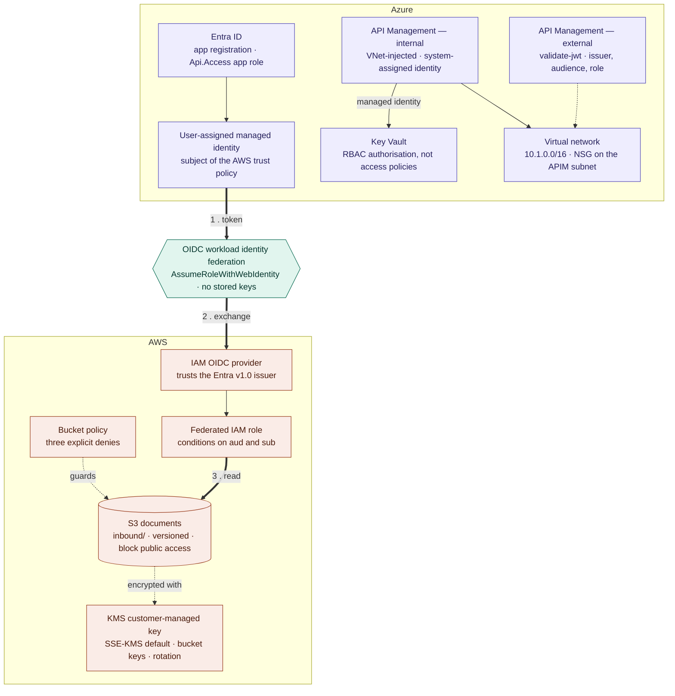
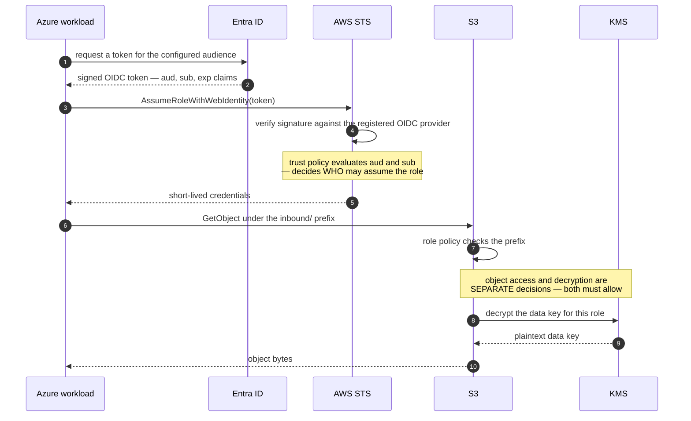
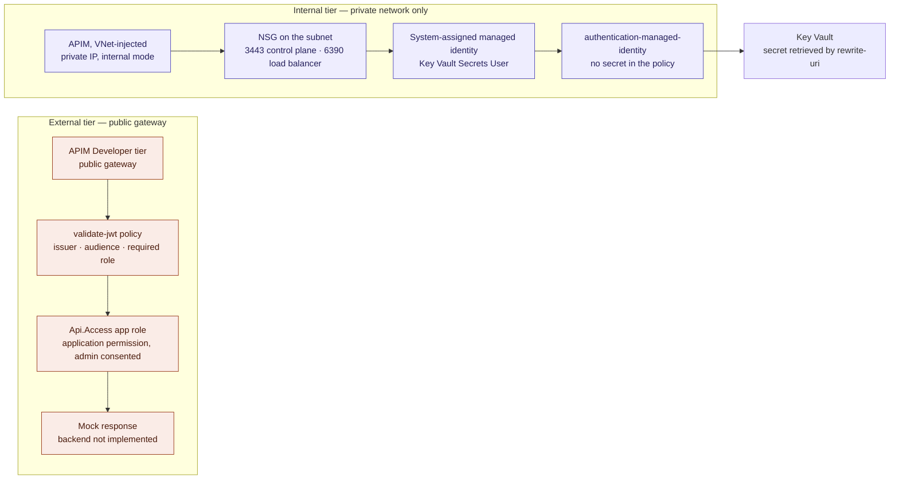
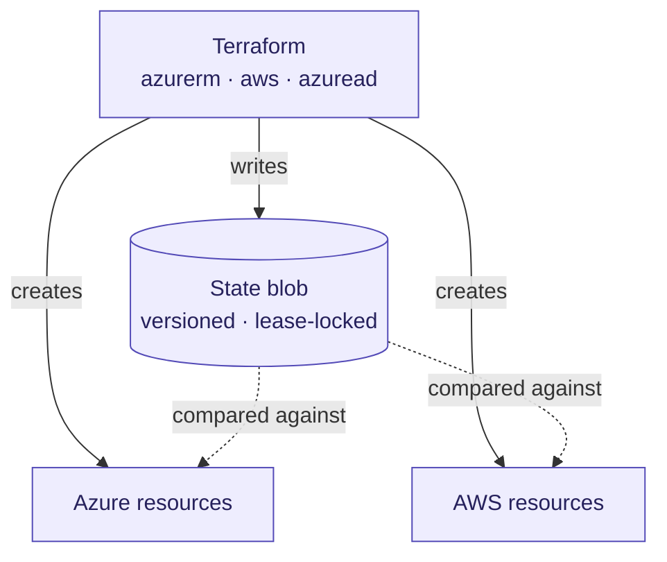

# Architecture

Four views of what this repository actually provisions. Reasoning for each choice lives in
[design-decisions.md](./design-decisions.md).

| View | Question it answers |
|---|---|
| 1 | What is the whole thing? |
| 2 | How does one cloud authenticate to the other? |
| 3 | Why are there two API tiers? |
| 4 | Where does the state live, and what holds it together? |

A section at the end lists what is **designed but not built**, so the diagrams above it can be
read as literal.

---

## View 1 — the whole thing



**Read it as one sentence:** documents live in an encrypted S3 bucket, and a workload on the
Azure side reads them holding no AWS key — it federates in and gets credentials that expire.

Both API tiers sit on the Azure side and are separate from the federation path. Bulk reads
would make a gateway a bottleneck, so analytics federates straight to S3 with a prefix-scoped
role. Different access pattern, different control.

---

## View 2 — the federation handshake



### There is no `:iss` condition key

The issuer is enforced **structurally**, by which OIDC provider ARN is named as
`Principal.Federated`. IAM exposes only `aud` and `sub` as condition keys on a web-identity
trust policy.

```hcl
Principal = { Federated = aws_iam_openid_connect_provider.entra.arn }
Action    = "sts:AssumeRoleWithWebIdentity"
Condition = {
  StringEquals = {
    "sts.windows.net/${var.tenant_id}/:aud" = var.federated_audience
    "sts.windows.net/${var.tenant_id}/:sub" = var.federated_subject
  }
}
```

The issuer string appears twice — once in the provider's `url`, and again as the **prefix on
every condition key**. Entra publishes two issuer forms for the same tenant,
`sts.windows.net/<tenant>/` (v1.0) and `login.microsoftonline.com/<tenant>/v2.0` (v2.0), and
AWS compares them literally. Mismatching them produces a valid token that the relying party
does not recognise.

### Three authorisation decisions, not one

| Decision | Enforced by | Governs |
|---|---|---|
| Who may assume the role | IAM trust policy on `aud` and `sub` | Identity |
| What that role may touch | Role policy, prefix-scoped | Object access |
| Whether it can be decrypted | `kms:Decrypt` on one key ARN | Decryption |

Remove the KMS grant and the read still fails — but the error surfaces as an S3
`AccessDenied` with no mention of KMS. Disabling the key itself is more honest about the
cause:

```
An error occurred (KMS.DisabledException) when calling the GetObject operation:
arn:aws:kms:...:key/... is disabled.
```

### The four negative tests

| Test | Result | What it proves |
|---|---|---|
| A different Entra managed identity attempts the exchange | `AccessDenied` at STS | The `sub` condition is load-bearing, not decorative |
| Reuse credentials past expiry | `ExpiredToken` | Credentials are genuinely short-lived |
| Read outside the permitted prefix | `AccessDenied` at S3 | The policy scopes the role, not just the bucket |
| Remove `kms:Decrypt`, keep `s3:GetObject` | `AccessDenied` | Key authorisation is a separate surface |

**A negative test is only valid if the acting identity is confirmed first.** An early run of
these gave a false pass: the login had silently failed and every command ran as subscription
Owner. `az account show --query user -o json` before trusting any result.

Same mechanism as EKS IRSA and GitHub Actions OIDC — Entra ID is just a different issuer.

---

## View 3 — two API tiers



| | External | Internal |
|---|---|---|
| Threat assumed | Token theft and replay | Lateral movement, over-broad service permissions |
| Authentication | Bearer token — OAuth2 / JWT | Platform-native managed identity |
| Why that choice | A stolen bearer token works from anywhere | A managed identity cannot be lifted out of the request |
| Reachability | Public gateway | Private IP, no public DNS record |
| Backend | Mock response | Key Vault over its own identity |

**Why the split at all:** external and internal traffic have genuinely different threat
models. Sharing one posture means either over-securing internal traffic or under-securing
external.

**What the external tier does and does not do.** The `validate-jwt` policy is real — it checks
the issuer, the audience and a required `Api.Access` app role against Entra's OpenID
configuration, and returns 401 on failure. The backend behind it is a mock response. It is a
working auth gate in front of nothing.

**401 versus 403 is the debugging shortcut.** 401 means fix the token — wrong audience,
expired, wrong issuer. 403 means fix the role assignment. No amount of RBAC will fix a 401,
because JWT validation happens offline against cached JWKS keys, before authorisation is
considered at all.

---

## View 4 — state and provisioning



One configuration, three providers, one state file. Every `plan` compares three things: the
code, the state, and what actually exists.

**Locking.** Terraform takes a **lease on the state blob** before writing. Azure Blob has a
native lease primitive; the AWS equivalent needs S3 for storage plus a DynamoDB table with a
conditional put. One service versus two, for the same job.

**The bootstrap problem.** The storage account that holds state cannot itself be created by
Terraform, because there is nowhere to keep *that* state. It is created once by CLI, in a
resource group that is never destroyed. This is the one acceptable hand-built resource.

**State is sensitive.** It contains secrets in plaintext, which is why the container has
public access blocked and why `*.tfstate` is in `.gitignore`. It is also not git — there is no
branching and no merge algorithm, so concurrent writes corrupt it rather than conflicting.

**Import.** Several resources were built by CLI first and adopted with `terraform import`.
Import writes *state*, not HCL — the configuration is still hand-written, and the real work is
reconciling the first `plan` until it comes back clean. A hand-written block is a guess; if it
omits something that is genuinely set, `plan` offers to modify the live resource to match the
guess.

**The near-miss worth recording.** A resource reference placed in a resource group's own
`name` field does not mean "point at that group" — it means "rename me to match it". On an
immutable field that is `-/+ destroy and recreate`, and it would have taken the VNet with it.
`plan` caught it before anything ran. That is the argument for the review gate: not process,
an actual save.

---

## Storage controls

| Control | Purpose |
|---|---|
| Block public access, all four flags | Removes the most common S3 failure mode outright |
| SSE-KMS with a customer-managed key | Encryption authority is separable from the bucket and revocable on its own |
| Bucket keys enabled | S3 caches a bucket-level key instead of calling KMS per object |
| Annual key rotation | New backing material, stable ARN, old objects stay readable |
| Versioning | Recovery from overwrite and deletion |
| `inbound/` prefix | Gives the role policy something meaningful to scope to |
| `DenyUnencryptedUploads` | A `PutObject` that is not SSE-KMS |
| `DenyWrongKey` | A `PutObject` encrypted under any other key |
| `DenyInsecureTransport` | Any action arriving over plain HTTP |

**Explicit `Deny` in a resource policy beats any IAM allow**, including the account root.
Azure RBAC has no equivalent — denial there comes from Azure Policy, a separate system
evaluated before RBAC.

### The `IfExists` trap

Both `PutObject` denies use `StringNotEqualsIfExists`, and the reason is worth stating.

| Operator | Header absent | Header present, wrong value |
|---|---|---|
| `StringNotEquals` | Deny fires | Deny fires |
| `StringNotEqualsIfExists` | Skipped | Deny fires |

An absent encryption header means "fall through to the bucket default", so skipping the check
is correct — policy evaluation happens *before* default encryption is applied, so the policy
cannot see the key S3 is about to use. With a bare `StringNotEquals`, every ordinary upload is
denied.

The same operator cuts the other way elsewhere. For something like
`aws:MultiFactorAuthPresent`, absent means "no MFA was used", and skipping creates a bypass.
You have to know whether a missing key means *safe* or *unsafe* in that specific case.

---

## Concept mapping

| AWS | Azure | Note |
|---|---|---|
| IAM | Entra ID **plus** Azure RBAC | Two layers: directory-level and resource-level |
| CloudFormation / CDK | Bicep / ARM | Terraform spans both |
| VPC | VNet | |
| Security group | NSG | Azure NSGs attach at subnet *and* NIC level; both are evaluated |
| S3 | Blob Storage / ADLS Gen2 | |
| KMS | Key Vault | Key Vault also covers secrets and certificates |
| API Gateway | API Management | |
| STS `AssumeRoleWithWebIdentity` | Workload identity federation | |
| S3 + DynamoDB lock table | Storage blob lease | Azure has a native lease primitive |

**The distinction most people get wrong:** Entra ID roles are *directory-level* — Global
Administrator, User Administrator — and govern the tenant. Azure RBAC roles are
*resource-level* — Owner, Contributor, Reader — and govern subscriptions, resource groups and
resources. AWS IAM collapses both into one system, which is why the split catches people
coming the other way.

A subscription Owner can delete a Key Vault and cannot read a secret inside it. The management
plane and the data plane are separate authorisation surfaces, expressed as separate endpoints:
`management.azure.com` versus `<vault>.vault.azure.net`.

---

## Designed but not built

The original design went further than this repository does. These are **not implemented** and
are listed so the views above can be read literally.

| Component | Status |
|---|---|
| AWS API Gateway tiers, WAF, Lambda, presigned URLs | Not built — the API tiers here are Azure APIM only |
| S3 event notifications, SQS, processing Lambda | Not built |
| CloudTrail object-level data events | Not built |
| AWS VPC, subnets, S3 gateway endpoint | Not built |
| Databricks, ADLS Gen2, the analytics pipeline | Not built |
| Private endpoints for Key Vault and Storage | Not built |
| Prometheus, Grafana, Log Analytics, cross-cloud KQL | Not built |
| Management group hierarchy, inherited Azure Policy | Not built — this is a Terraform-managed estate, not a landing zone |
| GitHub Actions deploying through federated credentials | Not built — there is no pipeline in this repository |
| Microsoft Defender for Cloud | Not built |
| Conditional Access | Not built — requires Entra ID P1 or P2; the lab tenant was free tier |

One custom RBAC role, `Document Platform Operator`, was built by CLI during an earlier phase
and never imported, so it does not appear in this configuration either.

**The Azure side is torn down.** The trial subscription expired, so the state blob is
unreachable and the Azure resources no longer exist. The AWS side is still deployed. What
remains here is the configuration.
