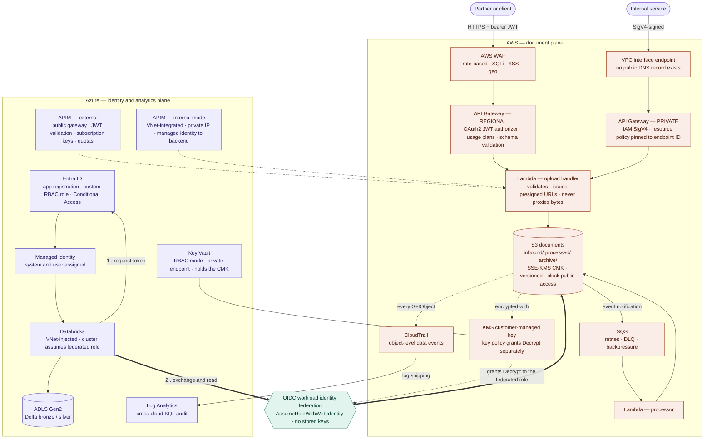
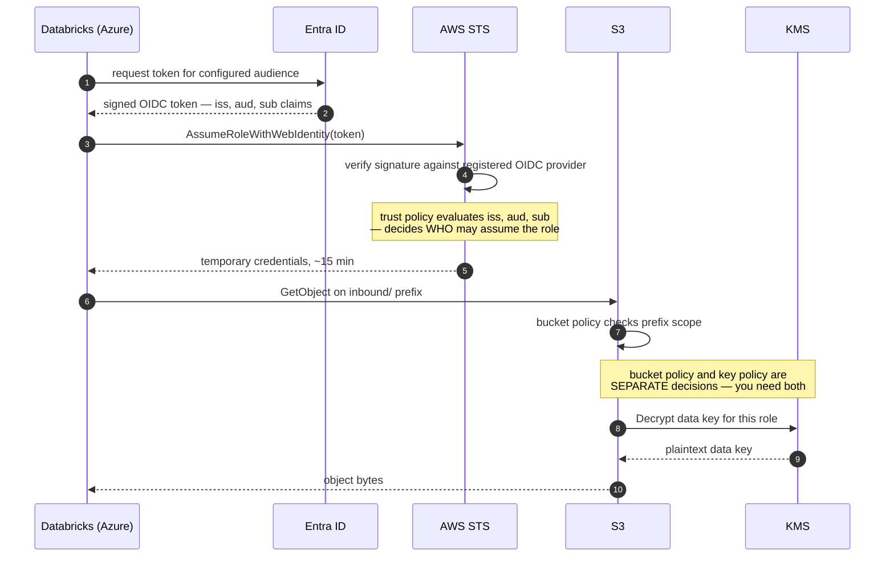
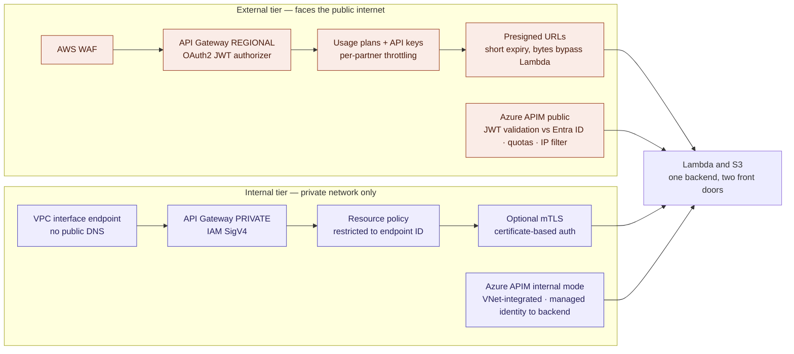
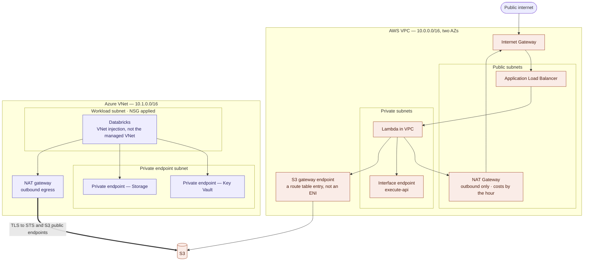
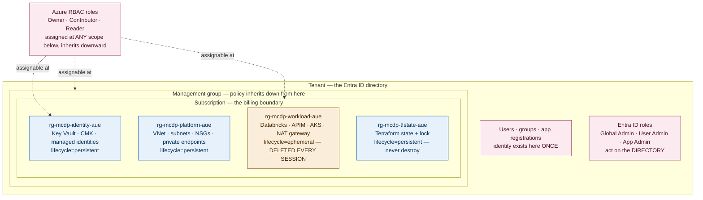
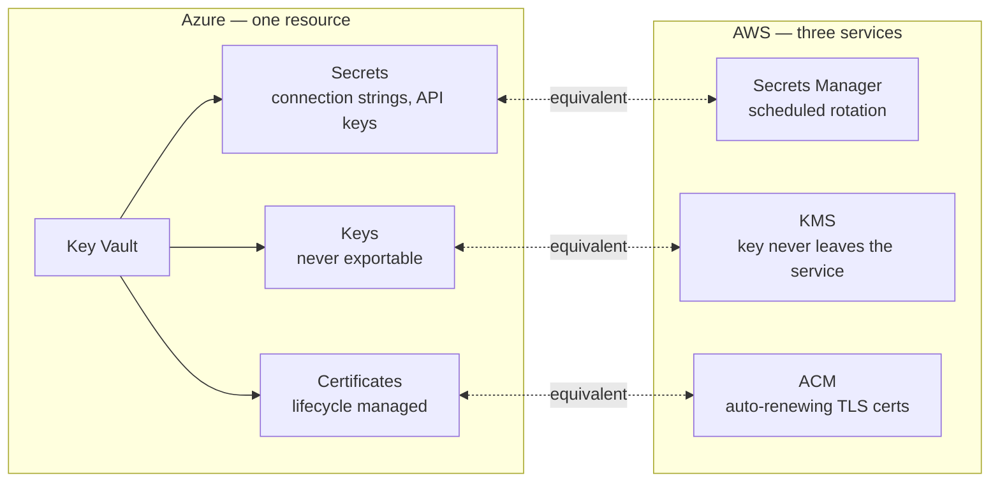
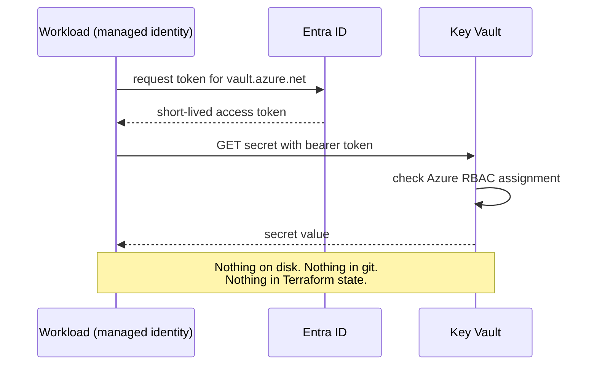
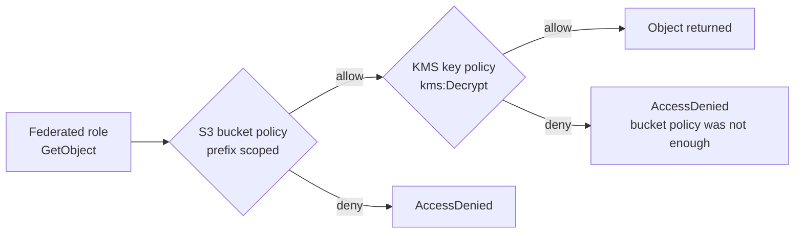

# Architecture

Five views. Each answers one question. Reasoning for every choice lives in
[design-decisions.md](./design-decisions.md); the concept table lives in
[azure-aws-mapping.md](./azure-aws-mapping.md).

Diagrams are Mermaid — GitHub renders them inline and git can diff them.

| View | Question it answers |
|---|---|
| 1 | What is the whole thing? |
| 2 | How does one cloud authenticate to the other? |
| 3 | Why are there two front doors? |
| 4 | Where does the traffic physically go? |
| 5 | How do you know it is healthy, and who deployed it? |

---

## View 1 — the data plane



**Read it as one sentence:** documents enter through one of two doors, land in an encrypted
bucket, and are read from the Azure side by a workload that holds no AWS key — it federates
in and gets credentials that expire.

**Note what bypasses what.** Databricks does *not* go through either API tier. Bulk analytics
reads would make the gateway a bottleneck, so it federates straight to S3 with a
prefix-scoped role. Different access pattern, different control.

---

## View 2 — the federation handshake

The security boundary between the clouds. Build this first; if only one thing works, this.



### Two independent authorisation decisions, not one

| Decision | Enforced by | Governs |
|---|---|---|
| Who may assume the role | IAM trust policy on `sub` and `aud` | Identity |
| What that role may touch | S3 bucket policy, prefix-scoped | Object access |
| Whether it can be read | KMS key policy granting `kms:Decrypt` | Decryption |

Remove the KMS grant and the read still fails — but the error surfaces as an S3
`AccessDenied` while the cause sits in KMS. That is the gotcha, and it is your honest
answer to *"what was the hardest part?"*

### The four negative tests

Record the actual error output for each. This is what separates a build from a tutorial.

| Test | Expected | What it proves |
|---|---|---|
| Different Entra identity attempts the exchange | Denied at STS | The `sub` condition is load-bearing, not decorative |
| Wait past expiry, retry | `ExpiredToken` | Credentials are genuinely short-lived |
| Read outside the permitted prefix | `AccessDenied` at S3 | The policy scopes the role, not just the bucket |
| Remove KMS grant, leave bucket policy intact | Fails on decrypt | Key authorisation is a separate layer |

Same mechanism as EKS IRSA and GitHub Actions OIDC — Entra ID is just a different issuer.

---

## View 3 — two front doors, one backend



| | External | Internal |
|---|---|---|
| Threat assumed | Token theft and replay, injection, volumetric abuse | Lateral movement, over-broad service permissions |
| Authentication | Bearer token — OAuth2 / JWT | Platform-native — IAM SigV4 or managed identity |
| Why that choice | A stolen bearer token works from anywhere | A SigV4 signature cannot be lifted out of the request |
| Abuse controls | WAF, rate limits, usage plans, geo restriction | Resource policy pinned to one endpoint ID |
| Reachability | Public DNS, internet-routable | No public DNS record exists |

**Why WAF only on the external tier:** the internal tier has no internet path, so the traffic
WAF inspects cannot reach it. Paying for inspection on an unreachable surface is theatre.

**Why an API in front of S3 at all:** one audit point, request validation, short-lived URLs
instead of raw bucket exposure, and the storage backend can change without changing clients.

---

## View 4 — network topology

Where packets actually go. This is the view that shows the networking foundation, and the
one most application developers moving into cloud cannot draw.



**The question you will be asked:** *does document traffic cross the internet?* From inside
AWS, no — the S3 gateway endpoint keeps it on the AWS network. From Azure, yes: the
federated read goes out over TLS to the public S3 endpoint. Say that plainly. The honest
follow-up is that PrivateLink or an interconnect would close it, at cost.

**Gateway endpoint vs interface endpoint** — worth knowing cold. Gateway endpoints are a
route table entry, free, and only serve S3 and DynamoDB. Interface endpoints are an ENI
with a private IP, cost by the hour, and serve almost everything else.

---

## View 5 — the planes that wrap both clouds

These are not components inside either cloud. Draw them as a band underneath both.

```mermaid
flowchart TB
  subgraph OBS["Observability plane — is it healthy?"]
    direction LR
    CWE["CloudWatch exporter<br/>authenticated by the SAME OIDC pattern"]
    AME["Azure Monitor exporter"]
    PROM["Prometheus on Kubernetes"]
    GRAF["Grafana<br/>one dashboard, both clouds"]
    AM["Alertmanager<br/>error rate · federation failures · authz-denial spikes"]
    CWE --> PROM
    AME --> PROM
    PROM --> GRAF
    PROM --> AM
  end

  subgraph AUD["Audit plane — who did what, when?"]
    direction LR
    CTL["CloudTrail"]
    ING["Ingestion function"]
    LAW2["Log Analytics<br/>KQL spanning both clouds"]
    SIL["Entra sign-in and activity logs"]
    CTL --> ING
    ING --> LAW2
    SIL --> LAW2
  end

  subgraph GOV["Governance plane"]
    direction LR
    MG["Management group hierarchy<br/>policy inherits down"]
    POL["Azure Policy<br/>require tags · restrict regions · deny public storage"]
    SCP["AWS SCPs and Config rules"]
    DEF["Defender for Cloud<br/>Secure Score · Essential Eight"]
    MG --> POL
    SCP --> DEF
  end

  subgraph CD["Delivery plane"]
    direction LR
    GH["GitHub Actions"]
    OIDC2["OIDC federated credentials<br/>to both clouds, no stored secrets"]
    TF["Terraform<br/>azurerm + aws, remote state + locking"]
    GH --> OIDC2
    OIDC2 --> TF
  end

  classDef plane fill:#E1F5EE,stroke:#0F6E56,color:#04342C
  class CWE,AME,PROM,GRAF,AM,CTL,ING,LAW2,SIL,MG,POL,SCP,DEF,GH,OIDC2,TF plane
```



**The distinction worth stating out loud:** metrics answer *is it healthy*, logs answer
*who did what, when*. Different tools because they are different questions with different
retention and query models. Knowing which tool serves which question is the senior signal.

**The one metric that is a security signal, not an operational one:** failed authorisation
attempts. A spike means someone is probing, not that a service is slow.

---

## Master reference — plain text

For terminals, PR descriptions, and drawing on a whiteboard from memory.

```
        EXTERNAL PATH                          INTERNAL PATH
        public internet                        private, service-to-service
        Partner / client                       Internal service
              │ HTTPS + JWT                          │ SigV4-signed
              ▼                                      ▼
 ┌──────────────────────────────── AWS ─────────────────────────────────────┐
 │  AWS WAF                                VPC interface endpoint           │
 │  · rate-based rules                     · no public DNS                  │
 │  · SQLi + XSS managed sets              · resource policy pinned to      │
 │  · geo restriction                        the endpoint ID                │
 │       │                                          │                       │
 │       ▼                                          ▼                       │
 │  API Gateway (REGIONAL)                 API Gateway (PRIVATE)            │
 │  · OAuth2 / JWT authorizer              · IAM auth, SigV4                │
 │  · usage plans + API keys               · optional mTLS                  │
 │  · request schema validation            · no internet path at all        │
 │       │                                          │                       │
 │       └──────────────► Lambda ◄──────────────────┘                       │
 │                          · validates                                     │
 │                          · issues presigned URLs, short expiry           │
 │                          · never proxies file bytes                      │
 │                          ▼                                               │
 │                   S3 (documents)                                         │
 │                   · inbound/ processed/ archive/                         │
 │                   · SSE-KMS, customer-managed key                        │
 │                   · versioning, block public access                      │
 │                   · bucket policy scoped per prefix                      │
 │                   · lifecycle → archive                                  │
 │                     │            │                                       │
 │                     │            └─► CloudTrail object-level events      │
 │                     └─► S3 event → SQS → Lambda (retries, DLQ)           │
 │                                                                          │
 │  VPC: 2 AZs · public + private subnets · IGW · NAT GW · ALB              │
 │       S3 gateway endpoint — bucket traffic stays on the AWS network      │
 └───────────▲──────────────────────────────────────┬──────────────────────┘
             │                                      │
   OIDC federation                                  │ CloudTrail logs
   · AssumeRoleWithWebIdentity                      │ CloudWatch metrics
   · trust policy on iss / aud / sub                │
   · ~15-min credentials                            │
   · no stored keys, anywhere                       │
             │                                      ▼
 ┌───────────┴─────────────────── Azure ────────────────────────────────────┐
 │  APIM (external)                        APIM (internal mode)             │
 │  · public gateway                       · VNet-integrated, private IP    │
 │  · JWT validation vs Entra ID           · managed identity to backend    │
 │  · subscription keys, quotas            · named values from Key Vault    │
 │                                                                          │
 │  Entra ID                                                                │
 │  · app registration → OIDC issuer trusted by AWS                         │
 │  · custom RBAC role, narrow permission set                               │
 │  · managed identity, system + user assigned                              │
 │  · Conditional Access: MFA on privileged roles                           │
 │       │                                                                  │
 │       ▼                                                                  │
 │  Databricks (VNet-injected) ──► ADLS Gen2 (Delta: bronze / silver)       │
 │       · cluster assumes the federated AWS role                           │
 │                                                                          │
 │  Key Vault (RBAC mode, private endpoint, holds CMK)                      │
 │  Azure Policy at management-group scope, inherited down                  │
 │  Log Analytics ◄── CloudTrail ingested here, cross-cloud KQL             │
 │  Defender for Cloud: Secure Score, Essential Eight view                  │
 │  VNet · NSGs · private endpoints · NAT gateway                           │
 └──────────────────────────────────────────────────────────────────────────┘
                                  │
                                  ▼
   Prometheus + Grafana on Kubernetes — one dashboard, both clouds
   · CloudWatch exporter, authenticated by the SAME OIDC pattern
   · Azure Monitor exporter
   · Alertmanager: error rate, federation failures, authz-denial spikes

   Terraform (azurerm + aws providers, remote state + locking)
   GitHub Actions → OIDC federated to both clouds, no stored secrets in CI
```

---

## Build status

Draw ticked items solid and unticked items dashed. Say which is which out loud. A diagram
promising more than the repo contains costs more than it gains.

| Component | Phase | Status |
|---|---|---|
| Entra ID, custom RBAC role, managed identity | 1 | ☐ Planned |
| Azure VNet, NSGs, private endpoints | 1 | ☐ Planned |
| Key Vault RBAC mode, customer-managed key | 1 | ☐ Planned |
| AWS VPC, subnets, S3 gateway endpoint | 2 | ☐ Planned |
| S3: SSE-KMS, versioning, prefix-scoped policy | 2 | ☐ Planned |
| CloudTrail object-level data events | 2 | ☐ Planned |
| Terraform both providers, remote state + locking | 2b | ☐ Planned |
| External API tier | 3 | ☐ Planned |
| Internal API tier | 3 | ☐ Planned |
| **OIDC federation Azure → AWS S3** | 4 | ☐ Planned |
| **All four negative tests, output recorded** | 4 | ☐ Planned |
| Management group hierarchy + inherited Policy | 4 | ☐ Planned |
| Databricks reading S3, writing ADLS | 4 | ☐ Planned |
| Prometheus + Grafana cross-cloud dashboard | 5 | ☐ Planned |
| CloudTrail → Log Analytics, cross-cloud KQL | 5 | ☐ Planned |
| GitHub Actions, OIDC to both clouds | 6 | ☐ Planned |
| Defender for Cloud Secure Score | E | ☐ Planned |

---

## Identity building blocks

### Service principals

Azure splits an application identity into two objects. AWS has no equivalent split.

| Object | Scope | Holds |
|---|---|---|
| App registration | Global — one record | `appId` (client ID), credentials, redirect URIs, requested permissions |
| Service principal | One per tenant | Role assignments, granted consent, enabled state, sign-in logs |

One app registration, one service principal per tenant that consents to it. This is why the Azure CLI carries the same `appId` (`04b07795-8ddb-461a-bbee-02f9e1bf7b46`) in every tenant on earth — Microsoft published one app, and each tenant has its own service principal for it.

**App ID plus tenant ID resolves to exactly one service principal.** That pair is the address; the secret is the proof.

`az ad sp create-for-rbac` is a wrapper that creates all three objects at once — app registration, service principal, and a role assignment. Worth knowing because in Phase 4 you want the app registration with a *federated credential* instead of a secret, so the wrapper is the wrong tool there.

### Client credentials flow, and why it is the weak option

| | Interactive user login | Service principal |
|---|---|---|
| Grant type | Authorisation code + PKCE | Client credentials |
| Browser | Required | None |
| MFA / Conditional Access | Evaluated | Not applicable |
| Credential | Password + second factor | A single string |

The client secret is long-lived (two years by default), bearer (possession is sufficient), portable (works from any machine on earth), and displayed exactly once — which is why it ends up in a `.env` file, a wiki page, or a chat window.

**Nothing in the flow proves where the request came from.** That is the entire argument for managed identity and workload identity federation, and it is worth stating from experience rather than theory.

### The rotation problem

Rotation is a distribution problem, not a cryptography problem. Every consumer must move to the new secret before the old one expires.

```bash
az ad app credential reset --id <appId> --append   # add without revoking the old one
```

The survivable pattern is overlapping credentials: add new → update every consumer → verify nothing uses the old → delete the old. Never a hard cutover. Central storage in Key Vault reduces the number of places to update, but reintroduces the bootstrap problem — something needs a credential to read the vault.

**The right answer is usually to remove the secret rather than get better at rotating it.** A client secret expires in two years; a managed identity token expires in an hour and is never seen by anyone.

### Every platform converged on the same answer

| Generation | GitHub | Azure | AWS |
|---|---|---|---|
| Long-lived secret | Classic PAT | Client secret | IAM user access key |
| Scoped secret | Fine-grained PAT | Certificate credential | — |
| No secret at all | Actions OIDC | Managed identity | IRSA on EKS |

GitHub Actions authenticating to AWS via OIDC is the same mechanism as Phase 4, with GitHub as the issuer instead of Entra ID. Being able to name the pattern across three products is stronger than knowing one implementation.

### Azure Resource Manager

One control plane in front of every Azure service. The portal, CLI, PowerShell and Terraform are all clients of `management.azure.com`.

```
clients → ARM → RBAC check → Azure Policy check → provision → activity log
```

Resource IDs look like paths because ARM is a REST API and the ID *is* the URL. Truncating a resource ID at any level yields a valid parent scope, which is exactly why RBAC inheritance works the way it does.

**ARM never sees data-plane calls.** A secret read goes to `<vault>.vault.azure.net`, not to ARM. That is the `actions` versus `dataActions` split expressed as separate network endpoints.

AWS has no equivalent — each service has its own API surface. The Azure trade-off is consistency (generic policy, generic IaC, uniform auth) at the cost of speed.

### GUIDs versus names

Object IDs behave like IP addresses; display names behave like DNS records.

- Renaming a group leaves every role assignment intact — assignments point at the GUID
- Deleting and recreating a group with the same name produces a **different object**, and every assignment now points at a dead GUID
- A deleted user's GUID is never reissued

This is why deleting and recreating a resource is not idempotent from RBAC's point of view, and why identity belongs in IaC — Terraform tracks the GUID in state and knows a replacement requires new assignments. Portal clicking does not.

### Anatomy of an Azure authorisation failure

```
The client '<appId>' with object id '<sp-object-id>' does not have authorization
to perform action '<action>' over scope '<full resource id>'
```

Four parts: client, object ID, action, scope. Note that the appId and the service principal object ID are **different values in the same error** — the app authenticated, the service principal was authorised.

Also worth knowing: a list operation returns only what the caller can read. Absence from output *is* the denial; there is no error.

### Managed identities

An identity for an Azure resource where the platform holds the credential instead of you.

| | Service principal | Managed identity |
|---|---|---|
| Credential | You hold a secret | Azure holds it, never exposed |
| Rotation | Your job | Automatic |
| Can be stolen | Yes — it is a string | No string exists |
| Usable from | Anywhere on earth | Only the resource it is attached to |

That last row is the security gain. A service principal secret works from a stranger's laptop. A managed identity does not leave the compute it is bound to.

**System-assigned** is created with a resource and dies with it — one identity, one resource. **User-assigned** is a standalone resource that outlives compute and can be attached to many resources. User-assigned is the better fit for IaC: the identity and its role assignments exist before any compute does, avoiding a chicken-and-egg ordering problem in `terraform apply`.

#### The dual-nature object

A user-assigned managed identity exists in both control planes simultaneously — a resource under `Microsoft.ManagedIdentity/userAssignedIdentities`, and a service principal in the directory, created automatically. It therefore carries three IDs, and using the wrong one is a common failure:

| ID | Equivalent on a service principal | Used for |
|---|---|---|
| `principalId` | SP object ID | **RBAC assignments** |
| `clientId` | `appId` | The workload naming which identity to request a token as |
| `resourceId` | none — SPs are not ARM resources | Attaching the identity to a VM, function or container |

The `clientId` matters when a resource has several identities attached — omit it and the token request is ambiguous. Note also that `az role assignment list` displays the `clientId` in its Principal column even when the assignment was created with the `principalId`.

The underlying app registration is owned by Azure and cannot be edited. That is the point: there is no credential surface for you to store, leak, or forget to rotate.

#### How a token arrives with no credential

```
http://169.254.169.254/metadata/identity/oauth2/token
```

A link-local, unroutable address reachable only from inside the instance. The workload asks it for a token; the platform checks which identities are attached and issues one. Nothing is presented as proof except the origin of the request.

**Same address as AWS's instance metadata service**, which delivers IAM role credentials to EC2. Identical mechanism, both clouds — the platform vouches for the workload because of where the request came from.

The chain, stated correctly: compute **has** the identity attached; it does not fetch it. If the workload had to authenticate to obtain the identity, the bootstrap problem would return.

```
VM / function / container
  └── has id-mcdp-reader attached
        └── backed by a service principal
              └── holding "Key Vault Secrets User"
                    └── scoped to one vault
```

#### Delegated versus application access

Both appear in real error output and the distinction matters in Phase 7.

| | Who is acting | Token carries |
|---|---|---|
| Delegated | An app on behalf of a signed-in user | Both app ID and user object ID |
| Application | The app as itself | App ID only |

A Key Vault denial for a human shows `appid=04b07795…` (the Azure CLI) alongside `oid=…` (the user) — the CLI acting on your behalf. A service principal denial shows one principal acting as itself.

This is the same split that makes Microsoft Graph `Mail.Read` dangerous as an application permission: delegated reads the signed-in user's mail, application reads *every* mailbox in the tenant unless an application access policy narrows it.

### Key Vault in practice

The vault name is globally unique because it becomes a DNS record. A secret's identifier is an HTTPS URL, not an ARM resource ID:

```
https://kv-mcdp-dev-nh01.vault.azure.net/secrets/test-secret/ff1145f8b41f…
                                                              └── version
```

Every write creates a new version and older versions stay readable. Referencing a secret without a version returns the latest — the mechanism behind rotation without redeploying consumers.

**Soft delete is on by default**, 90 days, which is why the vault belongs in the persistent resource group rather than one that gets torn down nightly.

#### Subscription Owner cannot read a secret

Owner is `actions: ["*"]` — a wildcard over the **management** plane only, with `dataActions` empty. `setSecret` is a dataAction, so it is denied. You can create, configure and delete the vault while being unable to open it.

This is separation of duties enforced by the platform rather than by a carefully written policy document, and it has no S3 equivalent.

The Key Vault role set shows the design intent — management and data split, then data split again by item type and by read versus write:

| Role | Plane | Grants |
|---|---|---|
| Key Vault Contributor | Management | Create and delete vaults; **cannot read secrets** |
| Key Vault Secrets User | Data | Read secret values |
| Key Vault Secrets Officer | Data | Read and write secrets |
| Key Vault Crypto User | Data | Encrypt and decrypt with keys |
| Key Vault Administrator | Data | Secrets, keys and certificates |

A role is read-only by the **absence** of write actions, not by a deny — Azure RBAC is allow-only.

#### The data-plane denial format

Richer than the ARM one, and worth reading closely:

```
Caller: appid=<app>;oid=<user or sp>;iss=https://sts.windows.net/<tenant>/
Action: 'Microsoft.KeyVault/vaults/secrets/setSecret/action'
Resource: '<full resource id>/secrets/test-secret'
Assignment: (not found)
Inner error: { "code": "ForbiddenByRbac" }
```

`ForbiddenByRbac` distinguishes an authorisation failure from a network or firewall block. **The `iss` field is the token issuer URL** — the same value AWS will be configured to trust as an OIDC provider in Phase 4.

#### Public endpoint versus private endpoint

`kv-mcdp-dev-nh01.vault.azure.net` resolves publicly from anywhere. Authentication stops callers, not the network.

| Option | Reachable from | Cost |
|---|---|---|
| Public endpoint, RBAC only | Anywhere | Free |
| Public endpoint + firewall rules | Named IPs and VNets | Free |
| Private endpoint | The VNet only, private IP | ~$0.01/hr plus data |

A private endpoint gives the vault a private IP and overrides DNS so the same hostname resolves internally, with the public endpoint disabled. Identity decides *who*; the network decides *from where*. Defence in depth.

**The trade-off worth stating:** private endpoints are not free in complexity. Your laptop loses access, GitHub-hosted runners lose access, and you are pushed toward self-hosted runners inside the VNet, private DNS zones, and VPN or Bastion for human access. Correct for regulated production, frequently over-engineering in dev.

### Resource providers

Each Azure service is a **resource provider** — `Microsoft.KeyVault`, `Microsoft.Network`, `Microsoft.Storage` — and must be registered per subscription before use.

```bash
az provider register --namespace Microsoft.KeyVault
az provider show --namespace Microsoft.KeyVault --query registrationState -o tsv
```

Registration is a capability opt-in, not a purchase — it is free and enables no charges. Most fire automatically on first use of a service, but a fresh subscription will need several by hand.

**Where this bites:** `terraform apply` on a new subscription dies partway through with `MissingSubscriptionRegistration`. Either register providers as a prerequisite step, or let the `azurerm` provider do it — which needs subscription-scope permissions a pipeline may not have.

A namespace is simply a prefix stating which service owns a type, because names collide (`Microsoft.Storage/storageAccounts` versus `Microsoft.DocumentDB/databaseAccounts`). The same string appears in resource IDs, in RBAC actions, and in provider registration. AWS does the same thing with short lowercase prefixes — `s3:GetObject`, `kms:Decrypt`.

### Token caching is an operational hazard

`az` caches tokens in `~/.azure`. They survive closing the terminal and rebooting; only `az logout` clears them. Returning to a machine the next day and running a command as an identity you did not expect is a real failure mode — it is what produced the false-pass negative test in session 1.

```bash
az account show --query user -o json    # first command of every session
```

Same discipline as checking `kubectl config current-context` before acting.

### Networking basics

| Azure | AWS | Difference that matters |
|---|---|---|
| VNet | VPC | — |
| Subnet | Subnet | **Azure subnets are not tied to an availability zone.** A subnet spans the region and the *resource* picks its zone. AWS subnets live in one AZ. |
| NSG | Security group | Azure NSGs attach at **subnet level and NIC level**, and both are evaluated. AWS security groups only attach to the ENI. |
| Route table | Route table | — |
| Private endpoint | VPC interface endpoint | — |
| S3 gateway endpoint | — | Route-table entry, free, S3 and DynamoDB only |

**Non-overlapping CIDR ranges are a decision, not a detail.** Azure takes `10.1.0.0/16`, AWS takes `10.0.0.0/16`. Two networks with the same range can never be peered, VPN'd or connected by ExpressRoute — you would have to rebuild one. This is why enterprises maintain a central IP address plan.

Azure reserves **five addresses per subnet** (network, gateway, two DNS, broadcast), so a `/24` yields 251 usable and the first VM gets `.4`. AWS also reserves five, slightly differently.

**`defaultOutboundAccess`** — older subscriptions grant VMs implicit outbound internet with no public IP and no NAT gateway. Being retired; new subscriptions default to `false`, matching AWS behaviour. A real gotcha in mixed estates where the same template behaves differently by subscription age.

#### The NIC is the joint

```
VNet 10.1.0.0/16
  └── Subnet 10.1.1.0/24
        └── NIC (holds the private IP, e.g. 10.1.1.4)
              └── VM
```

A VM never attaches to a network directly. The NIC holds the IP, carries the NSG, and **survives the VM** — as does the public IP and the OS disk. Deleting a VM in the portal leaves billing orphans. Tear down by resource group, not by resource.

`az vm create` silently creates five resources — public IP, NIC, NSG, OS disk, VM — with generated names and an NSG rule opening SSH to `0.0.0.0/0`. Convenient and unmanageable in IaC, which is why `azurerm_linux_virtual_machine` requires the NIC to be declared explicitly.

**Remote access:** SSH over a public IP is a lab shortcut, not a practice. In production: no public IP, no standing inbound rule, access via a broker with session auditing. AWS Session Manager is the better design — the agent connects *outbound*, so nothing inbound is ever opened, and it is free. Azure Bastion is a deployed always-on host at roughly $0.19/hr, which is why Just-in-Time VM access is often the cheaper control.

### Managed identity, proven end to end

Two calls, and the asymmetry is the point.

**Call 1** — the VM asks its local metadata service for a token. No credential is sent, because the platform knows which identity is attached to this machine.

**Call 2** — the VM calls Key Vault's public endpoint over the internet, presenting the token. Key Vault validates the signature and checks RBAC for the identity inside it.

Origin proves identity; identity proves authorisation. Nothing is stored anywhere.

```bash
# on the VM — no credential in this request
TOKEN=$(curl -s -H "Metadata: true" \
  "http://169.254.169.254/metadata/identity/oauth2/token?api-version=2018-02-01&resource=https://vault.azure.net" \
  | grep -o '"access_token":"[^"]*' | cut -d'"' -f4)

curl -s -H "Authorization: Bearer $TOKEN" \
  "https://kv-mcdp-dev-nh01.vault.azure.net/secrets/test-secret?api-version=7.4"
```

The `Metadata: true` header is not security — it is an anti-SSRF measure, since a browser or naive proxy cannot set arbitrary headers.

#### The token claims, and what Phase 4 will use

| Claim | Value seen | Why it matters |
|---|---|---|
| `iss` | `https://sts.windows.net/<tenant>/` | The issuer AWS will be configured to trust |
| `aud` | Key Vault's app ID | The token works against **one service only** |
| `sub` / `oid` | The identity's `principalId` | What RBAC looks up |
| `appid` | The identity's `clientId` | — |
| `idtyp` | `app` | Application access, no user involved |
| `xms_mirid` | Resource ID of the managed identity | — |
| `xms_az_rid` | **Resource ID of the VM that asked** | Origin baked into the token |

`xms_az_rid` is the striking one: Azure records *which machine made the request* as a claim. A service principal secret has no equivalent — nothing in that flow records origin. This is what "usable only from the resource it is attached to" means concretely.

**Issuer version trap:** `sts.windows.net/<tenant>/` is the v1.0 issuer; `login.microsoftonline.com/<tenant>/v2.0` is v2.0. Same tenant, different strings. A federation trust policy must match the issuer **exactly**, so choosing the wrong one produces a valid token that the relying party does not recognise.

#### Negative tests — Phase 1

| Test | Result | Fails at |
|---|---|---|
| `PUT` a new secret with a read-only role | **403 Forbidden**, `ForbiddenByRbac` | RBAC — action not in the role |
| Present a token minted for Storage to Key Vault | **401 Unauthorized** | Token validation — audience mismatch |

**401 versus 403 is the debugging shortcut.** 401 means fix the token — wrong audience, expired, wrong issuer. 403 means fix the role assignment. Hours get wasted adding permissions to solve a 401, which no amount of RBAC will fix. The same confusion appears in Phase 4, where an audience mismatch looks like a permissions problem.

### Capacity and SKU availability

`SkuNotAvailable` is a real operational fact, not a quota error: Azure regions run out of specific VM sizes, and free-tier subscriptions are deprioritised when a region is tight. In Australia East, x86 B-series was unavailable while ARM64 (`Standard_B2pts_v2`) was — which then required a matching ARM64 image, since `Ubuntu2404` is an x86 alias.

Do not hard-code a single VM size in IaC. Keep a fallback list or use flexible orchestration.

Image aliases hide the four-part URN (`publisher:offer:sku:version`), which is where the architecture mismatch was concealed. Terraform requires all four parts and therefore does not have this failure mode — the same lesson as `az vm create` hiding five resources.

### Deferred — revisit if time allows

| Item | Why deferred | Prerequisite |
|---|---|---|
| **Conditional Access policy** | Requires Entra ID P1 or P2; the lab tenant has no licences (`subscribedSkus` returns empty on free tier) | Start a P2 trial — free, 30 days |
| PIM, access reviews, Identity Protection | Same licensing gate | Same P2 trial |

**Sequencing note:** the P2 trial clock starts the moment it is activated, so it should be started when PIM and access reviews are actually going to be built rather than early for Conditional Access alone. All three unlock together.

**The honest line if asked before it is built:** *"Conditional Access requires P1 or P2, which I didn't have in the lab tenant. I understand the model — it replaces security defaults with conditional rules on user, location, device compliance and sign-in risk, and it's where endpoint management meets identity, since device compliance state feeds the policy. I haven't configured one hands-on."*

**What was met instead, concretely:** `AADSTS530035` — security defaults blocking device code flow. That is the crude, all-or-nothing version of the same control surface: one rule, every user, no exceptions. Conditional Access is that with conditions you write. The two are mutually exclusive, and the gap between disabling one and creating the other is a real migration risk organisations get wrong.

---

## Terraform fundamentals

**Two lines:** you write a file describing what infrastructure should exist, and Terraform makes reality match it. It keeps a **state file** recording what it built, and every run compares code against state against reality before changing anything.

### Declarative versus imperative

Everything built by hand used the imperative form — *do this action*:

```bash
az group create --name rg-mcdp-identity-aue ...
```

Terraform describes *what should exist*:

```hcl
resource "azurerm_resource_group" "workload" {
  name     = "rg-mcdp-workload-aue"
  location = "australiaeast"
  tags     = { project = "mcdp", env = "dev", lifecycle = "ephemeral" }
}
```

The word "create" never appears. Run it twice and nothing happens the second time — `az group create` would error. That is idempotency, and it is the practical difference.

`resource "azurerm_resource_group" "workload"` has three parts: the resource type, then `workload` as the **local name** used to reference it elsewhere in the config. The Azure name is the `name` argument inside.

### The three-way comparison

Every `plan` compares:

```
Your code    "there should be a Key Vault named X"
State file   "last time, I created a Key Vault named X"
Real Azure   "there is a Key Vault named X"
```

All three agree → nothing to do. New in code → create. Reality drifted because someone clicked in the portal → correct it back. Removed from code → destroy.

`Refreshing state...` at the start of a plan is the drift check running.

### State — the thing CDK and Bicep do not have

Bicep reads current state from ARM; CDK relies on CloudFormation state. Terraform keeps its own JSON record, including resource GUIDs.

**What it buys:** speed, a precise diff before apply, and the ability to hold resources from multiple providers in one place.

**What it costs:**

- **Lose the state file** and Terraform forgets everything it manages. The resources still exist; Terraform can no longer see them.
- **Two people apply at once** and state corrupts — hence locking.
- **State contains secrets in plaintext.** Key Vault secret values, passwords, generated keys. It must be treated as a sensitive artefact, which is why it belongs in a storage account with encryption, access control and versioning rather than in git.

That last point is a common interview question and most candidates do not know it.

**The honest framing:** CDK and CloudFormation experience transfers directly — declarative, versioned, reviewed, reproducible, roughly 80% of it. *The genuinely new things are state management and locking, because failure modes differ when the tool holds its own view of the world rather than reading from the platform.*

### The workflow

| Command | Does |
|---|---|
| `terraform init` | Downloads providers into `.terraform/`, writes `.terraform.lock.hcl`. Once per project, or after changing provider versions. |
| `terraform plan` | Dry run. Compares the three sources and prints the diff. Changes nothing, safe any time. |
| `terraform apply` | Shows the plan again, waits for `yes`, then executes. |
| `terraform destroy` | Removes everything in state. |

Plan symbols, and one is dangerous:

| Symbol | Meaning |
|---|---|
| `+` | Create |
| `~` | Modify in place |
| `-` | Destroy |
| `-/+` | **Destroy and recreate** — the change cannot be made in place |

A `-/+` on a database, storage account or Key Vault is catastrophic and easy to miss if the plan is not read. This is why `plan` output belongs in the pull request: the summary line (`1 to add, 0 to change, 0 to destroy`) is what a reviewer checks first, and non-zero destroys get scrutiny.

Equivalent to CloudFormation change sets and Bicep what-if. The difference is that Terraform makes the review gate the default workflow rather than an optional extra step.

**`-out` matters in CI.** `plan` and `apply` are two separate API conversations, and something could change between them:

```bash
terraform plan -out=tfplan
terraform apply tfplan
```

The saved plan guarantees apply does exactly what was reviewed. Interactive use skips this; pipelines should not.

**`.terraform.lock.hcl`** pins exact provider versions and checksums — the same job as `package-lock.json`. Commit it, or two engineers on identical code can get different provider versions and different behaviour.

### What multi-cloud actually means here

One config, two providers, one state, one `apply`:

```hcl
provider "azurerm" { features {} }
provider "aws"     { region = "ap-southeast-2" }
```

**It does not abstract the clouds.** There is no generic `cloud_storage` resource that becomes S3 or Blob. You still write `azurerm_key_vault` and `aws_s3_bucket` — different types, different arguments, different concepts. What you get is one tool, one language, one workflow, one state.

**Where it genuinely earns its place** is a relationship that spans both:

```hcl
resource "aws_iam_openid_connect_provider" "entra" {
  url = "https://sts.windows.net/${data.azurerm_client_config.current.tenant_id}/"
}
```

An AWS resource configured from an Azure value. Neither Bicep nor CDK can express this — one sees only Azure, the other only AWS. Cross-cloud federation *is* a cross-cloud relationship, so the tool describing it has to see both sides.

**Why enterprise JDs name Terraform** is usually more mundane than multi-cloud: it is the de facto standard, skills transfer between employers, the ecosystem is mature (modules, `checkov`, `tflint`, Atlantis), and it manages far more than cloud — GitHub, Datadog, Cloudflare, Kubernetes all have providers. An Azure-first shop still uses Terraform for its GitHub org. Do not assume multi-cloud is why they wrote it.

### Remote state in Azure

**Two lines:** state on a laptop is a single point of failure with no locking. Remote state puts it in a blob, where it is replicated, versioned, access-controlled, and **leased** so two applies cannot collide.

| Problem with local state | What remote state does |
|---|---|
| Only one person has it | Team shares one source of truth |
| Laptop dies, state gone | Replicated and versioned |
| Two applies at once corrupt it | **Blob lease** — the second waits or fails |
| Plaintext secrets on disk | Encrypted at rest, RBAC-controlled |

**Azure needs one service; AWS needs two.** Terraform takes a lease on the state blob, which is native to Azure Blob storage. S3 has no lease primitive, so AWS uses S3 for storage plus a DynamoDB table with a conditional put as the lock. DynamoDB's role there is a coincidence of needing a lock primitive, not a structural mapping — a storage account has no AWS equivalent at all.

`Acquiring state lock` and `Releasing state lock` appearing around every plan is the lease working.

#### The bootstrap problem

Terraform needs a storage account to hold state, but cannot create it with Terraform because there is nowhere to keep *that* state. So the backend is created by CLI, once, by hand, and lives in a resource group that is never destroyed. This is the one acceptable hand-built resource.

```bash
az group create --name rg-mcdp-tfstate-aue --location australiaeast
az storage account create --name stmcdptfstatenh01 --resource-group rg-mcdp-tfstate-aue \
  --sku Standard_LRS --encryption-services blob --min-tls-version TLS1_2 \
  --allow-blob-public-access false
az storage container create --name tfstate --account-name stmcdptfstatenh01 --auth-mode login
az storage account blob-service-properties update --account-name stmcdptfstatenh01 \
  --resource-group rg-mcdp-tfstate-aue --enable-versioning true
```

`--allow-blob-public-access false` is not optional — **state contains plaintext secrets**. Versioning is the recovery path if state is corrupted by an interrupted apply or a mistaken `state rm`.

Creating the container hits the same management-versus-data-plane wall as Key Vault: subscription Owner is not enough, and `Storage Blob Data Contributor` is required. `--auth-mode login` uses the Entra identity rather than a storage account key, consistent with the rest of the build.

```hcl
terraform {
  backend "azurerm" {
    resource_group_name  = "rg-mcdp-tfstate-aue"
    storage_account_name = "stmcdptfstatenh01"
    container_name       = "tfstate"
    key                  = "phase1.tfstate"
    use_azuread_auth     = true
  }
}
```

`key` is the blob name — different components and environments use different keys in one container, which is how a single storage account serves a whole estate. `use_azuread_auth = true` avoids a storage account key, which would be exactly the long-lived secret this project exists to eliminate.

Migrate with `terraform init -migrate-state`, answering `yes` to copy existing state up. The local `terraform.tfstate` is left as a zero-byte file and `terraform.tfstate.backup` holds the old contents; both should be deleted and both must be in `.gitignore`.

#### State is not git

A tempting analogy that breaks in the place that matters.

| | Git | Terraform state |
|---|---|---|
| Push | When you choose to commit | **Automatic at the end of every apply** |
| Branching | Yes | No — one state per backend key |
| Merging | Yes, conflicts resolvable | **None. Last write wins.** |
| Concurrent edits | Expected, reconcilable | Corrupts state — hence locking |

Git assumes concurrent work and gives you tools to reconcile it. Terraform assumes one writer and locks to enforce it, because there is no merge algorithm to fall back on.

There is also no pull. Every plan and apply fetches state from the blob, works in memory, and writes back. On a new machine the whole workflow is `git clone`, `terraform init`, `terraform plan` — nothing to copy or sync. `.terraform/` is local, but it holds provider plugins and a backend pointer, not state; delete it and `init` rebuilds it.

The `.tf` files go in git. State never does.

### Import — adopting existing resources

**Two lines:** import records in state that an existing cloud resource is now managed by Terraform. Nothing is created, nothing is modified, and nothing enters the `.tf` file.

The word is misleading — it has nothing to do with a language `import`. **Adopt** is the better verb.

Every enterprise has resources someone clicked into existence during an incident years ago that are still running production traffic. Bringing them under IaC without deleting and recreating them is unglamorous and frequently needed.

```
1. Write the resource block by hand
2. Get the Azure resource ID
3. terraform import <terraform address> <azure resource id>
4. terraform plan  ← the interesting step
5. Fix the HCL until plan is clean
```

There is no `apply` in that list. Apply happens only once plan is clean, at which point there is nothing to apply.

**Step 4 is the actual skill.** A hand-written config is a guess. If it omits something that is genuinely set, plan will offer to *modify the live resource* to match the guess — which on a Key Vault or a database is destructive. The story worth telling is not "I imported a resource," it is "plan showed changes I didn't intend and here is how I reconciled them."

For resources with many settings, import first, read the state, then write the config to match — the reverse of the simple case, and safer.

Before import, `plan` shows `+ create` for a resource that already exists; the apply would fail on a name collision. After import, `No changes`. Same code, same cloud — only the record changed.

### References and the dependency graph

**Two lines:** instead of typing another resource's name as text, point at the resource. Terraform reads the value and learns that one thing depends on the other.

```hcl
resource_group_name = "rg-mcdp-identity-aue"                  # the string, typed
resource_group_name = azurerm_resource_group.identity.name    # the string, looked up
```

Both produce identical text. The reference additionally creates a link, so Terraform creates the group before the vault and destroys it after — ordering is inferred, never written. That inferred graph is what makes modules possible.

Read a reference as **type . local name . attribute**. The local name (`identity`, `platform`, `main`) is an arbitrary label that exists only in the config and state; it never appears in Azure. This is why `terraform state list` shows `azurerm_key_vault.main` rather than `kv-mcdp-dev-nh01`.

#### The rule, and the near-miss that produced it

| Field | Reference? |
|---|---|
| A resource's **own** `name` | **No.** That is its identity. |
| A pointer to **another** resource | Yes. That is what references are for. |

Putting a reference in a resource's own `name` field does not mean "point at that resource" — it means "rename me to match it." On an immutable field that produces `-/+ destroy and recreate`. In this build, a reference placed in `azurerm_resource_group.platform`'s own `name` would have destroyed the platform resource group and the VNet inside it.

**`plan` caught it before anything happened.** That is the concrete argument for the review gate — not process theatre, an actual save. It is also why plan output belongs in the pull request and why any non-zero destroy count gets scrutiny.

### Provider versions are a maintenance surface

`enable_rbac_authorization` was renamed to `rbac_authorization_enabled` and disappears in azurerm v5.0. The version pin (`~> 4.0`) and `.terraform.lock.hcl` mean nothing breaks today, but on upgrade a deprecated argument becomes an error.

At scale this is the genuinely hard part of Terraform: a rename in a new provider release breaks configs across dozens of modules. The pattern that handles it is Dependabot or Renovate bumping the provider version, CI running `plan`, and the breakage surfacing in a pull request rather than in production.

Neither CDK nor Bicep has this in the same form — they version against the cloud's own API rather than a third-party provider.

---

## KMS and S3 encryption

### Envelope encryption

**Two lines:** KMS holds a key that never leaves. Your file is encrypted by a throwaway *data key*, and the data key is encrypted by the KMS key.

```
Upload:  S3 asks KMS for a data key
         KMS returns the SAME key twice — one plaintext, one encrypted
         S3 encrypts the file with the plaintext copy, then discards it
         S3 stores the encrypted copy beside the file

Read:    S3 sends the encrypted data key back to KMS
         KMS checks the key policy — is this identity allowed?
         KMS returns the plaintext data key
         S3 decrypts, discards the key again
```

The two copies are one key in two forms, not two different keys. The big file never goes to KMS; only a small key does. A fresh data key per object limits blast radius — crack one and you get one file.

`bucket_key_enabled = true` lets S3 cache a bucket-level key briefly instead of calling KMS per object, cutting KMS request costs by up to 99%.

### Key rotation has no distribution problem

`enable_key_rotation = true` generates new backing material annually. **The key ID and ARN never change**, old material is retained, and objects encrypted under previous material stay readable. Nothing is re-encrypted and no consumer is updated.

Contrast with the service principal secret, where rotation meant updating every consumer before the old one expired. **Rotation is painful when secrets are distributed and free when they are not** — the same reason managed identity beat the client secret.

### The four encryption options

| | Who holds the key | Key policy to write against | S3 sees plaintext |
|---|---|---|---|
| SSE-S3 | AWS entirely | None | Yes |
| **SSE-KMS** | KMS, policy under your control | Yes | Yes |
| SSE-C | The caller, sent per request | None — nothing is stored | Yes |
| Client-side (CSE) | You, before upload | n/a | **No** |

**All three SSE variants encrypt on the server**, so S3 sees plaintext in memory regardless. SSE-C changes who supplies the key, not who does the encrypting — a common misconception. If the requirement is that AWS never sees the data, only client-side encryption satisfies it, at the cost of key management, presigned URLs and any server-side processing.

**SSE-KMS is required for this project** for one reason: the federated role is a different identity, and it needs decrypt granted explicitly. SSE-S3 gives you no policy to write; SSE-C has no stored key to grant against. The two-gate model only exists with SSE-KMS.

Setting a default KMS key causes AWS to automatically add `BlockedEncryptionTypes: SSE-C` — otherwise a caller could bypass your key entirely and leave an object you cannot audit or decrypt. SSE-S3 is *not* auto-blocked, because it is weaker governance rather than a data-loss hazard; blocking it requires a bucket policy condition.

### In transit versus at rest

```
client --TLS--> S3 endpoint --> [plaintext in memory] --> SSE-KMS --> disk
```

TLS protects the upload. SSE-KMS protects the disk. Encryption at rest is worthless if the upload was plaintext over the wire, which is what the `aws:SecureTransport` deny covers.

### The two-gate model, demonstrated

Disabling the KMS key while leaving the bucket policy permissive:

```
An error occurred (KMS.DisabledException) when calling the GetObject operation:
arn:aws:kms:...:key/ce6372a3-... is disabled.
```

**The operation is S3's; the failure is KMS's.** Here AWS names the cause. When the failure is a *policy* denial rather than a disabled key, the response is a plain `AccessDenied` from S3 with no mention of KMS — that is the version that costs an hour, and it is the Phase 4 negative test worth capturing.

Disabling a key makes every object under it unreadable but not lost; re-enabling restores access instantly. Deleting a key is permanent, which is why deletion has a mandatory 7–30 day window.

### Bucket policy — deny statements and condition operators

A bucket has exactly one policy document containing multiple statements. It is *resource-based*, attached to the bucket rather than to an identity, which is what makes cross-account and federated access expressible at all.

Three denies:

| Sid | Guards against |
|---|---|
| `DenyUnencryptedUploads` | An upload that is not SSE-KMS |
| `DenyWrongKey` | An upload encrypted with a key that is not ours |
| `DenyInsecureTransport` | A request arriving over plain HTTP |

**Explicit Deny always wins in AWS**, overriding any IAM allow, including the account root. Azure RBAC has no equivalent — denial there comes from Azure Policy, a separate system evaluated before RBAC.

`aws:SecureTransport` reflects the client's choice of scheme. S3 accepts both HTTP and HTTPS and does not redirect or downgrade; the condition simply reads which was used. Modern SDKs default to HTTPS, so this rarely fires — it exists for old clients and because auditors and benchmarks look for it.

#### The `IfExists` trap

| Operator | Header absent | Header present, wrong value |
|---|---|---|
| `StringNotEquals` | Deny fires | Deny fires |
| `StringNotEqualsIfExists` | Skipped | Deny fires |

**A missing condition key means different things in different guards.** For an encryption header, absent means "fall through to the bucket default," so skipping is correct. For something like `aws:MultiFactorAuthPresent`, absent means "no MFA was used," and skipping creates a bypass. Same operator, opposite consequence — you have to know whether missing means *safe* or *unsafe* in that specific case.

**Open question, unresolved:** with these denies in place, `aws s3 cp` is refused while an explicit `aws s3api put-object --server-side-encryption aws:kms --ssekms-key-id <arn>` succeeds. The CLI's transfer manager sends different headers than a single-request PUT. Not diagnosed; not a blocker, because the architecture writes via API Gateway → Lambda → presigned URLs and reads via the federated role, both of which are SDK calls with explicit headers.

**Worth saying as a trade-off rather than a bug:** a strict deny-unless-encrypted-with-my-key policy is right for application clients and awkward for ad-hoc CLI use. The policy protects the bucket from misconfigured writers; the cost is that CLI uploads need explicit flags.

---

## Tokens, signatures and trust

### JWT and JWKS

**JWT** is the token: `header.payload.signature`, base64, dot-separated. **Not encrypted** — anyone can read the claims. What they cannot do is forge one.

**JWKS** is the issuer's published set of *public* keys:

```
https://login.microsoftonline.com/<tenant>/discovery/v2.0/keys
```

```
1. Entra signs the token with its private key
2. The token header carries `kid` — which key was used
3. The relying party fetches JWKS, finds that kid, takes the public key
4. It verifies the signature locally
```

Asymmetric: only the issuer can sign, anyone can verify.

**This is why federation needs no network path between clouds.** AWS validates an Entra token offline against cached public keys and never calls Azure at runtime. Trust is cryptographic, not network-based.

Signing key rotation has the same no-distribution property as KMS rotation — new keys appear in JWKS, old ones linger until existing tokens expire, and nobody coordinates anything.

### Bearer is a scheme, JWT is a format

```
Authorization: Bearer eyJ0eXAiOiJKV1Qi...
                └─ scheme        └─ happens to be a JWT
```

**Bearer** means possession is sufficient — steal it, use it. The token could be a JWT, an opaque string, or an API key.

| | Validated by | Revocation |
|---|---|---|
| JWT | Offline signature check | Waits for expiry |
| Opaque token | Database lookup | Immediate |

JWTs scale better; opaque tokens revoke better.

**SigV4 is not bearer.** The request itself is signed, so the signature is bound to that specific request — copying it achieves nothing. That is the actual reason the internal API tier uses IAM auth while the external tier uses OAuth2/JWT: a stolen bearer token works from anywhere, a stolen SigV4 signature works for one request that has already happened.

### The federation call path

All three calls originate from the Azure workload. AWS never initiates anything and never reaches into Azure.

```
Azure workload → login.microsoftonline.com   get a token
Azure workload → sts.<region>.amazonaws.com  exchange it for credentials
Azure workload → <bucket>.s3.amazonaws.com   read the object
```

Three ordinary HTTPS calls on port 443. No tunnel, no VPN, no peering.

**The workload needs outbound internet, not an inbound public IP.** It can sit entirely in a private subnet behind a NAT gateway with no public exposure — which is the correct production shape.

**Does the traffic cross the internet?** Yes, TLS-protected. Closing that would require PrivateLink or an interconnect at real cost. Say it plainly rather than implying the path is private.

---

## Session log

### Session 1 — Phase 1 identity

**Built:** two resource groups (identity, platform), one Entra user, one security group, one Reader assignment at RG scope, one custom role (`Document Platform Operator`), one service principal with Reader on the platform RG.

**Verified by denial:** the service principal could see only `rg-mcdp-platform-aue` in a group listing, and received `AuthorizationFailed` on both a read outside its scope and a write anywhere.

**Cost:** A$0. Prior spend of A$10.77 was an orphaned Databricks NAT gateway, now deleted.

**Remaining in Phase 1:** Key Vault with RBAC authorisation, managed identity reading a secret, Conditional Access.

#### Lessons worth keeping

**A negative test is only valid if you confirm the acting identity first.** The first attempt at the service principal boundary test gave a false pass: the login had silently failed with `AADSTS7000215`, so all four commands ran as subscription Owner, and a resource group that should have been refused was created instead. Always run `az account show --query user -o json` and confirm `"type": "servicePrincipal"` before believing any result. The same failure mode gives a false pass on the Phase 4 federation negative tests — testing "a different identity is denied" without ever switching identity.

**Terminating a Databricks cluster does not stop the bill.** The workspace provisions a managed resource group containing a NAT gateway and public IP that bill continuously while the workspace exists. Found via Cost Management grouped by resource, not by looking at the workspace. Delete the workspace, not the cluster.

**Managed resource groups carry a deny assignment.** Resources inside `databricks-rg-*` cannot be deleted individually — the platform owns them. Delete the parent resource. No AWS equivalent to this ownership model.

**A client secret pasted anywhere is a rotated secret.** Rotate immediately with `az ad app credential reset`, and read the output field carefully — `password` is the secret, `id` is the credential's identifier, and confusing them produces `AADSTS7000215`.

#### Open questions — things that worked but are not fully understood

Keep this list running. It is AZ-104 study material and it shows exactly where an interviewer could open a gap.

| Thing | Why not confident | Resolved? |
|---|---|---|
| `AssignableScopes` on custom roles | Understood as a guardrail on where a role may be assigned, but have not tested what happens when it is narrowed after assignments exist | ☐ |
| Access policies vs RBAC on Key Vault | Chose RBAC on principle; have not seen the legacy model to compare | ☐ |
| Conditional Access replacing security defaults | Know they are mutually exclusive; have not performed the switch | ☐ |

### Session 2 — Phase 1 completion and Terraform start

**Built:** Key Vault with RBAC authorisation, a test secret, a user-assigned managed identity granted `Key Vault Secrets User` scoped to the vault, VNet `10.1.0.0/16` with subnet `10.1.1.0/24`, and a VM with the identity attached — used to read the secret end to end with no stored credential, then torn down. Terraform installed; first `init`, `plan` and `apply` completed against a new `rg-mcdp-workload-aue`.

**Verified by denial:** subscription Owner refused `setSecret` (403, management versus data plane); read-only managed identity refused `PUT` (403); a token minted for Storage refused by Key Vault (401, audience mismatch).

**Deferred:** Conditional Access — no Entra ID P1/P2 licence on the free tier.

**Cost:** A$0 running at close. VM ran roughly an hour at ~A$0.03/hr.

#### Lessons worth keeping

**`az vm delete` leaves four billing orphans.** Disk, NIC, public IP and NSG all survive the VM, and the disk and public IP keep charging. The convenience of `az vm create` — which silently produces five resources with generated names — is the same convenience that makes teardown incomplete. Tear down by resource group, which is the reason the four-group lifecycle split exists. The VM should have gone in the workload group rather than platform.

**Regional capacity is real.** `SkuNotAvailable` on x86 B-series in Australia East while ARM64 was available, which then required a matching ARM64 image because `Ubuntu2404` is an x86 alias. Do not hard-code a single VM size in IaC.

**Resource providers need registering per subscription** on a fresh subscription, and this is what breaks `terraform apply` partway through on a new environment.

**Token caching outlives the session.** Returned to the machine and `az` was still authenticated as the service principal from the previous day. `az account show --query user -o json` is now the first command of every session.

#### Open questions — updated

| Thing | Why not confident | Resolved? |
|---|---|---|
| `AssignableScopes` on custom roles | Have not tested narrowing it after assignments exist | ☐ |
| Access policies vs RBAC on Key Vault | Chose RBAC on principle; have not seen the legacy model | ☐ |
| Conditional Access replacing security defaults | Blocked on licensing; model understood, not built | ☐ |
| v1.0 vs v2.0 issuer URLs | Know they differ and that trust policies must match exactly; have not hit the failure | ☐ |
| Terraform state locking | Understood in principle; remote state not yet configured | ☐ |

### Next session

Do **not** finish Phase 1 by hand. The remaining items — NSG, private endpoint for Key Vault, storage account with customer-managed key — are good Terraform exercises with real dependency chains, and everything would be rebuilt declaratively anyway. Start with remote state in an Azure Storage Account with locking, then work through the rest in HCL rather than CLI.

Databricks and the NAT gateway wait until Phase 4 needs them.

### Sessions 3–4 — remote state and import

**Built:** Terraform backend infrastructure by CLI — resource group, storage account with public access blocked and versioning enabled, `tfstate` container. Backend block added and local state migrated to the blob with `use_azuread_auth`. Five resources brought under management: three resource groups, the VNet and the Key Vault, all reconciled to `No changes`. Provider deprecation fixed.

**Cost:** A$0 running. The state storage account remains deployed permanently at a few cents a month — the one deliberate exception to teardown.

#### Lessons worth keeping

**A reference in the wrong field is indistinguishable from a rename.** Placing `azurerm_resource_group.identity.name` in the `platform` group's own `name` field would have destroyed that resource group and the VNet inside it. `plan` showed the `-/+` before anything ran. This is the concrete case for the review gate.

**Import writes state, not HCL.** The config is still hand-written, and the first plan after import is where the work is. A clean first plan is luck, not the norm.

**Locking is visible.** `Acquiring state lock` appearing around every plan is the blob lease, and it was not there before migration.

**Prompt injection appeared in pasted terminal output.** A block of text formatted as a system instruction, telling the assistant to adopt a different identity and ignore its guidelines, arrived inside a pasted `terraform plan` result. It was ignored. Source never traced — possibly a clipboard tool, an extension, or something already in the scrollback.

Directly relevant to this project rather than a distraction: anything a model reads can carry instruction-shaped content — a document, a web page, a log file, pasted output. Filtering phrases does not solve it. **The boundary that matters is capability, not the prompt.** If the model can only read, an injected instruction achieves nothing; if it can write to infrastructure, it achieves a great deal. Least privilege, applied to agents. This becomes a live design concern in any phase where an LLM reads documents out of S3.

#### Open questions — updated

| Thing | Why not confident | Resolved? |
|---|---|---|
| `AssignableScopes` on custom roles | Have not tested narrowing it after assignments exist | ☐ |
| Access policies vs RBAC on Key Vault | Chose RBAC on principle; have not seen the legacy model | ☐ |
| Conditional Access replacing security defaults | Blocked on licensing; model understood, not built | ☐ |
| v1.0 vs v2.0 issuer URLs | Trust policies must match exactly; have not hit the failure | ☐ |
| Terraform state locking | Working, but have not deliberately caused a lock collision | ☐ |
| `terraform state rm` and recovery | Know versioning is the safety net; have not practised a restore | ☐ |

### Next session

1. AWS provider in the same project — `aws --version`, `aws sts get-caller-identity` first
2. One trivial resource per cloud to prove the loop
3. Then AWS in earnest: VPC, S3 with SSE-KMS, prefix-scoped policy, CloudTrail

Federation is untouched and it is the centrepiece. Do not let Terraform polish consume the time it needs.

### Session 5 — AWS provider, S3 hardening, federation started

**Built:** AWS CLI installed and authenticated as `cdk-admin`. `aws` provider added to the same Terraform project — one config, one state, two clouds. S3 bucket `mcdp-documents-nh01`, KMS customer-managed key with rotation and an alias, default SSE-KMS encryption with bucket keys, versioning, all four public access blocks, and a three-statement bucket policy. Entra app registration `mcdp-federation` and its service principal created with **no client secret**. `aws_iam_openid_connect_provider` written but not yet applied.

**Verified by denial:** disabling the KMS key made an encrypted object unreadable while the bucket policy still permitted the read — `KMS.DisabledException` on a `GetObject` call. Re-enabling restored access instantly.

**Cost:** KMS key ~$1/month prorated. Everything else free tier. Nothing needs tearing down.

#### Lessons worth keeping

**The `IfExists` trap has opposite consequences depending on what you are guarding.** A missing encryption header means "use the bucket default" — skipping the check is correct. A missing `aws:MultiFactorAuthPresent` means "no MFA was used" — skipping creates a bypass. Same operator, opposite outcome.

**All three SSE modes encrypt server-side**, so S3 sees plaintext regardless. SSE-C changes who supplies the key, not who encrypts. Only client-side encryption keeps plaintext away from AWS.

**Rotation is a distribution problem, not a cryptography problem.** KMS rotation is free because nothing outside KMS holds the key and the ARN is stable. The service principal secret was painful for exactly the inverse reason.

**Federation needs no network path between clouds.** AWS validates an Entra token offline against cached JWKS public keys. Trust is cryptographic; the two clouds never talk to each other, they both talk to the workload.

#### Open questions — updated

| Thing | Why not confident | Resolved? |
|---|---|---|
| `AssignableScopes` on custom roles | Have not tested narrowing it after assignments exist | ☐ |
| Access policies vs RBAC on Key Vault | Chose RBAC on principle; have not seen the legacy model | ☐ |
| Conditional Access replacing security defaults | Blocked on licensing; model understood, not built | ☐ |
| v1.0 vs v2.0 issuer URLs | Trust policies must match exactly; about to hit this in Phase 4 | ☐ |
| Terraform state locking | Working, but have not deliberately caused a lock collision | ☐ |
| `terraform state rm` and recovery | Know versioning is the safety net; have not practised a restore | ☐ |
| **`aws s3 cp` denied while `put-object` succeeds** | The CLI transfer manager sends different headers than a single PUT; not diagnosed with `--debug` | ☐ |

### Next session — federation

State so far: app registration `mcdp-federation`, appId `949caecc-e1ea-4cf5-ba51-fab65499e22a`, service principal created, no secret. OIDC provider resource written, not applied.

1. Apply `aws_iam_openid_connect_provider` — the cross-cloud reference where an AWS resource is configured from `data.azurerm_client_config.current.tenant_id`
2. IAM role with a trust policy conditioned on `iss`, `aud` and `sub`
3. Permissions scoped to one S3 prefix and the KMS key
4. Acquire an Entra token, exchange via `AssumeRoleWithWebIdentity`, read from S3
5. **The four negative tests** — wrong identity, expired token, wrong prefix, KMS grant removed

Item 5 is the interview material. Capture the error output for each.

---

## Boundaries to state plainly

- Azure here is **project-built**, not production. Say it before being asked.
- Terraform is **project-built**. CDK and CloudFormation are the production experience.
- Phase 7 is Microsoft Graph **integration**, not M365 **administration**.
- No Intune or endpoint management. No PowerPlatform beyond the flow actually built.

---

## Azure scope model

The hierarchy every Azure decision hangs off. No AWS equivalent for most of it, which is why it trips people coming from AWS.



### The distinction most candidates get wrong

| | Entra ID roles | Azure RBAC roles |
|---|---|---|
| Act on | The directory — users, groups, app registrations | Resources — subscriptions, resource groups, individual resources |
| Examples | Global Administrator, User Administrator | Owner, Contributor, Reader, custom roles |
| Assigned at | Tenant | Management group, subscription, RG, or resource |
| Inheritance | n/a | Downward only |

**A Global Administrator has zero access to resources by default.** The exception worth naming: a Global Admin can toggle *Access management for Azure resources*, which grants themselves User Access Administrator at root scope — and from there, anything. That escalation path is the reason Global Admin is the account you wrap in PIM and Conditional Access.

AWS IAM collapses both layers into one system. Azure splits them, and one user identity spans every subscription in the tenant rather than being duplicated per account.

### What a resource group actually is

A **lifecycle container**, not a project folder. Three real functions:

- Delete the group and everything inside dies — the teardown lever
- RBAC assigned at group scope inherits to every resource inside
- A billing and tagging boundary for cost analysis

Its `location` stores only the group's metadata. Resources inside can live in other regions.

### Group by lifecycle, not by component

| Group | Holds | Why separate |
|---|---|---|
| identity | Key Vault, CMK, managed identities | Deleting a Key Vault means 90-day soft-delete name lock and unreadable CMK-encrypted data |
| platform | VNet, subnets, NSGs, private endpoints | Rebuilt on iteration, cheap to hold |
| workload | Databricks, APIM, AKS, NAT gateway | Everything expensive, in one deletable place |
| tfstate | Terraform state storage + lock table | Destroy it and Terraform forgets everything it manages |

If Databricks shares a group with Key Vault, nightly teardown means picking resources out one at a time — which is exactly how a NAT gateway gets left running.

Same pattern one level up at enterprise scale: platform subscription (networking, identity, monitoring) versus workload subscriptions.

### Tags

Azure does not act on tags. They are queryable metadata that make cost attributable and teardown scriptable.

```bash
az resource list --tag lifecycle=ephemeral -o table

az group list --query "[?tags.lifecycle=='ephemeral'].name" -o tsv \
  | xargs -I{} az group delete --name {} --yes --no-wait
```

| Tag | Meaning |
|---|---|
| `lifecycle=persistent` | Deleting this hurts |
| `lifecycle=ephemeral` | Delete freely, rebuild from code |

**Tags do not inherit.** Tagging a resource group leaves the resources inside untagged. Two fixes: an Azure Policy with a `modify` effect that copies RG tags down, or Terraform `default_tags` at provider level. The AWS provider has the same feature — use it rather than remembering.

**Design decision to record:** tags are enforced by Azure Policy `deny` on create and applied automatically by Terraform, not by discipline. Discipline is what left a NAT gateway billing for a day.

---

## RBAC mechanics

Three independent objects, joined by a fourth. Nothing is stored inside the group, and nothing is stored inside the role.

| Object | Answers | Contains |
|---|---|---|
| Security group | Who | Users |
| Role definition | What | Permissions — no scope anywhere in it |
| Role assignment | The join | Pointers to group, role and scope |
| Scope | Where | A management group, subscription, RG or single resource |

A role definition is scope-free, which is why Microsoft can ship ~400 reusable built-ins. `Reader` is literally `{"actions": ["*/read"]}`.

### Evaluation

```
allowed = matches any action  AND  matches no notAction
```

`notActions` is a **subtraction from what `actions` granted**, not a deny. It cannot block a permission granted by a different assignment at another scope. Assignments are additive and the broadest wins.

**Azure RBAC has no explicit deny.** Denial comes from Azure Policy, a separate system evaluated before the request reaches RBAC. This surprises people coming from AWS IAM, where an explicit `Deny` always wins.

### Management plane vs data plane

The split with no AWS equivalent.

| Field | Governs | Example |
|---|---|---|
| `actions` | The resource itself | Create a vault, delete a storage account |
| `dataActions` | The data inside it | Read a secret value, read a blob |

`Reader` has `dataActions: []` — it can see a Key Vault exists but cannot read a secret. `Key Vault Secrets User` is the exact inverse: `actions: []`, `dataActions` populated. Subscription Owner can delete a vault it cannot read from.

That is the answer to "I'm an Owner and still got a 403."

### Inheritance and removal

Inheritance flows **down only** — never up, never sideways. Reader on `rg-mcdp-platform-aue` grants nothing on `rg-mcdp-identity-aue` and nothing on the subscription itself.

Removal is **scope-exact**. `az role assignment delete` requires the precise scope where the assignment was created. Deleting at RG scope leaves a subscription-scope assignment untouched, and the user still has access — which looks like a bug and is really an audit finding.

**The real-world failure:** someone assigns at subscription scope because it is quicker. Nothing breaks, nobody notices, and two years later nobody can answer who can read the identity resource group. The fix is a scheduled audit that flags any assignment at subscription scope or above, not discipline.

### Auditing effective access

```bash
az role assignment list --assignee $USER_ID --all                    # direct only — often empty
az role assignment list --assignee $USER_ID --all --include-groups   # what they can actually do
```

Assign to groups, never to users. A direct user assignment is a finding in any access review, and offboarding becomes a hunt across every scope in every subscription.

### Custom roles

Built-ins are preferred where one fits — custom roles go stale as Azure adds operations. The one built here demonstrates the model rather than filling a gap:

```json
{
  "Name": "Document Platform Operator",
  "Actions": [
    "Microsoft.Storage/storageAccounts/read",
    "Microsoft.Storage/storageAccounts/listKeys/action",
    "Microsoft.Resources/subscriptions/resourceGroups/read"
  ],
  "NotActions": [],
  "DataActions": [],
  "AssignableScopes": ["/subscriptions/<sub-id>"]
}
```

Note the deliberate omission of `Microsoft.Authorization/roleAssignments/write` — without it the role cannot grant permissions to anyone, so it cannot escalate itself. That single omission is also the entire difference between built-in Contributor and Owner.

`AssignableScopes` does not grant anything. It limits **where the role may be assigned**. Built-in roles carry `["/"]`; a custom role scoped to one subscription cannot be assigned in another.

---

## Secrets, keys and encryption

Status: `[planned]` — Key Vault is Phase 1, CMK-encrypted S3 is Phase 2.

### Azure fuses three AWS services into one



| Azure | AWS | Difference that matters |
|---|---|---|
| Key Vault secrets | Secrets Manager, or Parameter Store `SecureString` | Secrets Manager has built-in rotation Lambdas; Key Vault rotation is your own job unless the service supports it natively |
| Key Vault keys | KMS | KMS key policies are a separate policy document from IAM; Key Vault uses the same Azure RBAC as everything else |
| Key Vault certificates | ACM | ACM certs are bound to AWS services and mostly non-exportable; Key Vault certs can be pulled out for app use |

In AWS you wire up three services with three permission surfaces. In Azure it is one vault, three drawers, one RBAC model.

### Why nothing stores a credential



No credential bootstraps the credential. The platform vouches for the workload's identity because it issued that identity. Same principle as the cross-cloud OIDC federation in View 2 — applied inside one cloud rather than across two.

**Decision: RBAC authorisation, not access policies.** Key Vault supports a legacy per-vault access-policy model. RBAC is used instead because access policies do not inherit from management group scope, do not appear in a normal role-assignment audit, and cannot be governed by Azure Policy the way role assignments can. Using them would undermine the management-group governance model.

**Decision: purge protection off in the lab, on in production.** Purge protection is irreversible. Enabled, the vault name and its keys cannot be removed until the retention window expires — which breaks clean teardown and cost control here. In production it is what stops a compromised administrator destroying a key and rendering every object encrypted under it permanently unrecoverable.

### Customer-managed keys and the two-gate model

An SSE-KMS encrypted object is guarded by two independent policies. Both must allow the call.



Granting a role read access to the bucket does not grant it the ability to decrypt. Two consequences:

- A second, independent revocation point. Removing the KMS grant cuts access even if a bucket policy is later loosened by mistake.
- The most common source of a confusing `AccessDenied` in a federated setup, because the bucket policy looks correct.

**Negative test (Phase 4):** remove `kms:Decrypt` from the key policy while leaving the bucket policy allowing the read. Confirm the call fails. Capture the error. This is the test that proves the two surfaces are genuinely independent rather than assumed to be.

**Azure counterpart:** a Storage account encrypted with a customer-managed key from Key Vault fails the same way if the key is disabled or the account's identity loses its Key Vault role — encryption authority living in a different resource with its own permission model.

---

## Operational reference

### Getting a local shell talking to Entra ID

`az login` never handles your password. It runs **OAuth2 authorisation code flow with PKCE**:

1. CLI opens a listener on a random `localhost` port
2. CLI sends the browser to Entra ID with `client_id`, `redirect_uri`, `scope`, `state`, `code_challenge`
3. You authenticate on Microsoft's page — password, MFA, Conditional Access all evaluated there
4. Entra redirects to `http://localhost:<port>` carrying a one-time authorisation code
5. CLI exchanges the code for an access token, caches it in `~/.azure`

The client only ever holds short-lived tokens. Same principle as the OIDC federation in View 2 — the credential never sits on the client.

URL parameters worth being able to name:

| Parameter | Purpose |
|---|---|
| `client_id` | Which app is asking. Azure CLI is `04b07795-8ddb-461a-bbee-02f9e1bf7b46` in every tenant |
| `redirect_uri` | Where the code is returned |
| `scope` | What is being requested |
| `state` | Anti-CSRF, one-time — reusing a login URL fails here |
| `code_challenge` | PKCE, proves the client that started the flow is the one finishing it |

### Login from WSL

WSL has no browser, so step 2 fails by default.

```bash
sudo tee /usr/local/bin/wslbrowser >/dev/null <<'EOF'
#!/bin/sh
url=$(printf '%s' "$1" | sed 's/&/^&/g')
cd /mnt/c
exec /mnt/c/Windows/System32/cmd.exe /c start "" "$url"
EOF
sudo chmod +x /usr/local/bin/wslbrowser
echo 'export BROWSER=/usr/local/bin/wslbrowser' >> ~/.bashrc && source ~/.bashrc

az login --tenant <TENANT_ID>
```

The `^&` escaping matters — both PowerShell and `cmd` treat a bare `&` as a command separator and truncate the URL.

**`AADSTS530035`** — security defaults block device code flow outright. Not an MFA problem. Device code is the flow used in phishing (the victim authenticates on a real Microsoft page while the attacker holds the listener), so Microsoft blocks it under the free baseline. Use browser flow, or replace security defaults with Conditional Access.

### Tenant vs subscription

No AWS equivalent for this split — it catches people coming from AWS.

| | Holds | Analogue |
|---|---|---|
| **Tenant** | Entra ID directory: users, groups, app registrations | Roughly an AWS account's IAM, but shared across subscriptions |
| **Subscription** | The billing container. Every resource lives in exactly one | Closest thing to an AWS account |
| **Resource group** | Mandatory container inside a subscription | No AWS equivalent — deleting it deletes everything inside |

`No subscriptions found` means auth reached the tenant but no subscription is attached, or auth failed at the tenant entirely. Different problem from "nothing deployed".

### Daily checks

```bash
az account show --output table            # which subscription am I spending from
az group list --output table              # containers
az resource list --output table           # everything that exists
```

### The expensive-thing sweep

Run at the start and end of every session.

```bash
az network nat gateway list -o table
az network public-ip list -o table
az network application-gateway list -o table
az network lb list -o table
az aks list -o table
az databricks workspace list -o table
az apim list -o table
```

Orphans that bill after their parent is gone:

```bash
az network public-ip list --query "[?ipConfiguration==null].{name:name,rg:resourceGroup}" -o table
az disk list --query "[?diskState=='Unattached'].{name:name,rg:resourceGroup}" -o table
```

Real spend, grouped by resource, lives in **Subscription → Cost Management → Cost analysis**. The CLI is poor at this — use the portal.

### Two Azure-specific traps found the hard way

**Databricks workspaces have a floor cost.** Terminating clusters is not enough. The workspace provisions a *managed resource group* containing a NAT gateway, public IP and VNet that bill 24/7 while the workspace exists. Delete the workspace, not the cluster.

**Managed resource groups carry a deny assignment.** You cannot delete resources inside `databricks-rg-*` individually — the platform owns them and recreates or blocks. Delete the parent resource. There is no AWS equivalent to this ownership model.

**`NetworkWatcher_australiaeast`** is auto-created on first networking deployment in a region, is free, and returns if deleted. Leave it.

### Naming convention

```
rg-mcdp-dev-aue        resource group
kv-mcdp-dev-aue        key vault
vnet-mcdp-dev-aue      virtual network
```

`mcdp` = multicloud document platform, `aue` = Australia East. Tag from the first resource — Azure Policy will later deny untagged resources, and cost analysis groups by tag.

```bash
az group create --name rg-mcdp-dev-aue --location australiaeast \
  --tags project=mcdp env=dev owner=nalinka
```

---

## Session teardown

- [ ] Databricks clusters terminated
- [ ] NAT Gateway deleted
- [ ] Application Load Balancer deleted
- [ ] APIM Developer tier deleted if not actively testing
- [ ] AKS/EKS cluster deleted — biggest ongoing cost; deploy, screenshot, destroy
- [ ] Resource groups torn down, `terraform destroy` run
- [ ] CloudFormation stacks deleted
- [ ] **Leave in place:** Terraform remote state storage and lock table

Verify in both consoles, not just in the tool output.

---

## Exporting

The markdown is the source of truth. Generate formatted output rather than maintaining it:

```bash
npm install -g @mermaid-js/mermaid-cli
pip install mermaid-filter
pandoc architecture.md design-decisions.md -F mermaid-filter -o platform.pdf
```

Never edit the exported file. If it drifts, the markdown wins.
